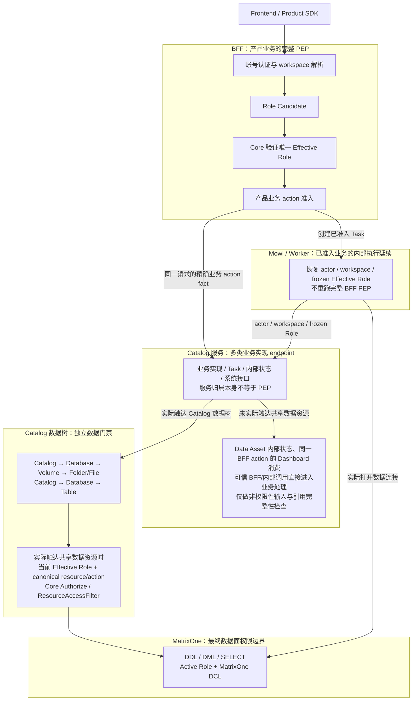

# MOI IAM 架构与信任边界

本文定义 MOI 权限系统的组件职责、事实所有权和跨服务信任边界。资源/action 的具体产品语义见[业务功能权限模型目录](08-business-permission-model-catalog.md)，当前接入状态见[实现状态](05-implementation-status.md)。

## 1. 总体链路

```text
moi-frontend / Product SDK
          |
          v
moi-backend: authentication + PEP + Core client
          |
          v
moi-core/catalog: IAM Core + canonical stores + PDP
          |
          +----> Shared Authorization Engine
          |
          +----> Catalog owner services / MatrixOne DCL adapter
          |
          v
moi-core/mowl -> workers: durable runtime continuation
          |
          +----> 独立逻辑数据资源 / MatrixOne 边界：接收方重新鉴权
          |
          +----> 已登记的 BFF 业务对象或内部状态延续：仅传递可信 transport/审计上下文
```

Core `Authorize` 加 Shared Authorization Engine 是唯一 PDP。调用链中的其它组件均不能持有独立 allow 逻辑。Mowl 只能恢复已准入 Task 的内部执行上下文；只有进入 Catalog 数据树或 MatrixOne 数据边界时，接收方才按自己的 resource/action 调用 Core。Catalog 的非数据树业务接口不因位于 Catalog 进程而成为第二个 PDP：已通过 service identity、API key 或 mTLS 确认来源的 BFF 和内部调用均由 Catalog 无条件信任并直接进入业务 handler；Data Asset 内部状态和 Dashboard 等非数据树接口不要求或校验 execution contract，也不在 Catalog 重做业务授权。Worker 的窄 continuation 只约束发送端的登记和调用面，非数据树 Catalog 接收端不以 continuation 做授权判断。

可信 BFF 到 Catalog 的调用可以无条件进入非数据树业务接口；这里的“可信”仅指来源已由 service identity、API key 或 mTLS 确认，不等同于任意未认证代理。可信内部调用同样直接进入非数据树业务接口。`coreclient` 只在调用方选择发送 execution contract 时校验并编码该封闭合同，不根据 URL、`coreclient.Execute`、raw proxy 或布尔字段推断模式。`bff_complete_pep` 必须携带真实 canonical action facts，主要用于审计和链路记录；非数据树 Catalog 不重复校验这些 facts，也不自行拼装 allow。真实 Catalog 数据树可以接收专用 receiver transport 或完整 `bff_complete_pep` 作为身份和 Verified Effective Role 输入，但 data owner 必须屏蔽 BFF business trust，只复用 Core 为当前顶层 BFF 请求生成的精确数据树计划；未覆盖范围才进入 Core `Authorize` / `ResourceAccessFilter`。Verified Effective Role 在同一顶层请求中最多验证一次，可信 Admin/SuperAdmin 直接取得全量数据树范围，见[请求级授权裁决复用](11-request-authorization-decision-reuse.md)。知识库初始 provisioning 在 `semantic_model.create` 产品准入后，仍由 Catalog 生成边界对默认 Catalog 校验 `database.create`；只有初始 raw/processed 根 Volume 不单独检查 `volume.create`，不能据此跳过数据库准入。MatrixOne DDL 和新资源 Ownership 仍归冻结的用户 Role，后续数据访问继续走数据树 PDP。Worker 只能由登记的 sender 使用 exact continuation 元数据；非数据树 Catalog 不以 continuation 做授权判断。`data_asset_state_v1` 只是可选 sender metadata，不能作为任何接口的 allow。

### 1.1 产品 PEP、运行期延续与数据门禁



图中的“Catalog 服务”是进程与实现归属，不是自动产生 PDP 的资源类型。只有进入图中的 Catalog 数据树分支时，才按实际的 Catalog、Database、Volume、Folder/File 或 Table 执行独立数据门禁；无论入口来自 BFF 还是 Worker，最终 DDL/DML/SELECT 都仍由 MatrixOne 的 Active Role 与 DCL 裁决。

## 2. 组件职责

| 组件                        | 权限职责                                                                                                                                                                                                                                                                                                                                                                             | 禁止事项                                                                                                                                |
| --------------------------- | ------------------------------------------------------------------------------------------------------------------------------------------------------------------------------------------------------------------------------------------------------------------------------------------------------------------------------------------------------------------------------------ | --------------------------------------------------------------------------------------------------------------------------------------- |
| Frontend                    | 提供 Role 选择、发送显式候选、展示 stable error 和可用能力                                                                                                                                                                                                                                                                                                                           | 本地计算 allow；把展示名当 Role 事实                                                                                                    |
| Product SDK                 | 包装 Backend 产品 API，只传递已发布的强类型业务字段                                                                                                                                                                                                                                                                                                                                  | 直连 Core；把通用 custom header 当作 Role 合同；推断 Default Role；隐藏 Backend 错误                                                    |
| Backend                     | 账号认证、workspace/Role Candidate 解析、可信资源提取、调用 Core、执行 deny                                                                                                                                                                                                                                                                                                          | 本地 policy、binding shortcut、角色并集、system fallback                                                                                |
| Core client                 | 统一签名、transport、Role Candidate、Verified Effective Role 和链路上下文传输；只校验/编码明确命名的 execution contract                                                                                                                                                                                                                                                              | 将候选标记成已验证；按 URL、raw proxy 或上游布尔值推断 contract；把非数据树 BFF admission 传成数据树 receiver allow；吞掉 Core 错误分类 |
| IAM Core                    | 验证 Effective Role，读取 canonical facts，执行 Authorize/Filter，写 IAM 事实和审计                                                                                                                                                                                                                                                                                                  | 信任外部 allow；从 legacy 表读取授权事实                                                                                                |
| Shared Authorization Engine | 对 Core 提供纯裁决内核                                                                                                                                                                                                                                                                                                                                                               | 独立加载业务存储或成为第二事实源                                                                                                        |
| Catalog（非数据树）          | 对已确认可信来源的 BFF 调用无条件信任并进入业务 handler；不要求 `bff_complete_pep`，不执行业务 PDP。Data Asset 内部状态、Dashboard 和 Workflow/Runtime 内部状态只做必要的 workspace/引用完整性检查；有权限模型的批量读接口可按过渡约定使用 `ResourceAccessFilter` | 自行拼装 allow/deny、根据 owner/system principal 放行、把可选 execution contract 当作额外门禁，或让非数据树逻辑绕过数据树门禁 |
| Catalog 数据树与 MatrixOne | Catalog 数据树在入口解析可信资源和运行上下文，使用 authenticated principal、workspace 和 Verified Effective Role 按自身 resource/action 调用 Core；MatrixOne 使用同一已验证 Role 的数据面事实；数据树必须在自己的 `Authorize` / `ResourceAccessFilter` 前屏蔽 BFF trust | 继承 BFF action 作为数据树 allow；按 runtime actor/system owner/旧签名本地 allow；让 raw proxy、generic prepare 或 BFF marker 绕过真实数据树 PDP   |
| Mowl/Worker                 | 冻结、恢复并消费 Task 运行上下文；普通出站时只传 actor/workspace/Effective Role；Worker 发送端可按登记的窄 continuation 标注特定内部调用，供审计和上下文传递；Catalog 非数据树接收端不以该标注重做授权                                                                                                                           | 为内部 dispatch/retry/recovery 重新鉴权；把 durable allow 或 continuation 元数据作为下游 allow，或把窄登记泛化为 grant/capability                      |
| MatrixOne adapter           | 应用并 readback DCL/Active Role 终态                                                                                                                                                                                                                                                                                                                                                 | 将 MatrixOne Role 反向当成 Application IAM Role                                                                                         |

Frontend 的当前权限上下文由 App Shell 的 `/newmoi/user/info` bootstrap 投影产生。Frontend 只能消费同一次 Core projection 返回的 Effective Role、capability 和 snapshot，不能通过串行拼接 Role 列表、permission code 或对象权限恢复本地 allow。

## 3. PEP、PDP 与 PAP

### 3.1 PEP

Backend middleware 是公开产品操作的 PEP；Catalog 只有进入真实数据树时才承担独立数据 resource/action 的 PEP。Catalog 非数据树业务接口接受已确认可信 BFF 的调用，不重复成为业务 PEP；它们只做必要的输入、workspace tenant 和内部引用完整性检查。PEP 只做：

1. 解析可信 workspace、resource、parent 和 Role Candidate。
2. 在入口边界调用 Core Effective Role verification、`Authorize` 或 `ResourceAccessFilter`；只有同一 Core 请求中完全相同的 actor、Role、resource 和 action 才能复用已产生的 Core 决策。
3. 根据 Core 结果继续或拒绝。
4. 透传 request/trace/audit context。

PEP 不得读取 Role binding、policy、Ownership 或 legacy cache 自行组合 allow。持久化的 owner classification 只用于审计；恢复时不能据此重建 `IsWorkspaceOwner`、`BusinessActionAuthorized` 或其它 allow/skip fact。

Mowl 内部运行延续不是新的 PEP；WorkItem 进入 Catalog 数据树或 MatrixOne 数据边界时，接收方才是该 resource/action 的 PEP。Data Asset 内部状态、Dashboard 和其它 Catalog 非数据树接口对可信 BFF/内部调用无条件通过，不把可选 execution contract、system credential、冻结 Role 或上游 action 扩大为数据资源 allow；有权限模型的批量读接口可以保留明确登记的 `ResourceAccessFilter` 过渡例外。system credential 只认证内部 transport，不能替代数据树或 MatrixOne 的业务授权。完整场景边界见[请求级授权裁决复用](11-request-authorization-decision-reuse.md)。

### 3.2 PDP

IAM Core 负责：

- 验证 principal、workspace、membership、direct binding、Role 和 lifecycle；
- 把唯一 Role Candidate 固化为 Verified Effective Role；
- 从 canonical Registry 解析 operation/resource/action；
- 读取 Application Policy、Role graph、Ownership 和 specific grant；
- 调用 Shared Authorization Engine；
- 为 point check 和 collection filter 返回同源决策；
- 记录可解释的决策和审计事实。

### 3.3 PAP

PAP 只负责 Role、Policy、inheritance、binding、Default Role 和 Ownership 等管理事实的校验、写入、版本控制与发布。PAP 不能在请求运行期直接给业务 handler 放行。

Ownership 是只增加 allow 的授权事实，不是资源存在性、业务 lifecycle 或 readiness 事实。canonical 业务对象仍存在而 exact-key Ownership 缺失、non-active、畸形或字段不完整时，Owner 来源只是不参与本次裁决；这不是 deny，也不是授权依赖错误。普通 Role 的显式 `all`、specific、parent 和 path grant 继续由 owner service 的 canonical resolver 证明资源、workspace、层级和业务 lifecycle。Core 不从 workspace owner、业务字段或请求上下文在运行期补造 owner；历史完全缺失记录的默认 `superadmin` 只由单次补录物化，补录失败只写日志。

对当前已验证的 `admin`/`superadmin`，Core 按 system Role 的 Application IAM all-access 裁决，不预查目标 metadata 或 Ownership。point 由后续 owner service 查询决定是否返回 `404`，collection/tree/picker 的 canonical policy `all` 与 system all-access 统一生成 `all` plan，并由同一次业务 SQL 处理 workspace、逻辑删除和 lifecycle。显式 specific/parent/path plan 由 canonical 业务层级事实限制 ID；Owner 派生 ID 的查询与最终结果证明才要求 active Ownership。权限事实或业务 storage 读取失败仍 fail closed。

## 4. Canonical 事实源

| 事实                                                               | Owner                                                      |
| ------------------------------------------------------------------ | ---------------------------------------------------------- |
| 用户、workspace membership、invitation、user profile               | Core system storage / workspace service                    |
| Role、direct binding、Default Role、Role graph、Application Policy | Core tenant IAM storage                                    |
| resource/action/operation/route binding                            | Core canonical IAM Registry                                |
| Ownership、specific grant、lifecycle operation、IAM audit          | Core tenant IAM storage                                    |
| 应用业务对象及 parent/workspace 解析                               | 对应 Catalog owner service                                 |
| MatrixOne user/role/grant/active role                              | MatrixOne；Core adapter 负责投影和 readback                |
| UC 账号、已验证邮箱/手机号映射                                     | Backend identity directory；只输出 canonical `moi_user_id` |

PermissionService、permission code、retired permission tables、Backend route policy map、前端菜单配置和 SDK DTO 都不是授权事实源。

## 5. 裁决读取一致性

Core 对 canonical facts 的读取必须形成可验证的同一裁决快照：

- Application Policy 文档和 Grant Index 在同一 tenant transaction 写入；workspace policy generation 与写入同时递增。PDP 在读取前后校验 generation，变化或缺失时 fail closed，由新请求重新读取完整事实。
- Role graph resolver 用单条 storage 查询读取 MatrixOne 管理命名空间内完整 role-grant edge 的不可变快照，再在内存中校验节点、边、cycle 和 lifecycle。不设深度、节点数和边数上限，不截断 MO 返回的完整图；缺失、损坏或已有循环的授权事实仍按现有 Core 规则拒绝裁决。继承写入的防环和并发正确性由 MO 负责，MOI 不在写链路实现兜底。
- Core 只允许同一请求内复用 principal projection、Role graph 或 lifecycle fact bag，并在最终裁决 fence 读取当前 lifecycle。缺少覆盖全部授权事实的 aggregate lifecycle version 前，不启用跨请求 decision cache。

这些约束同时适用于 point `Authorize` 与 `ResourceAccessFilter`，防止二者在 policy、Role graph 或 lifecycle 变化时看到不同事实。

## 6. Effective Role 信任边界

Backend 可以携带候选，不能宣布候选已验证。Core 验证完成后，普通跨受保护服务 transport 只包含：

- `workspace_id`：已解析的目标 workspace；
- `principal_id`：已认证账号映射出的 canonical principal；
- `VerifiedEffectiveRoleID`：Core 已验证的当前唯一 Role；
- request/trace/audit 标识：仅用于链路和审计。

`VerifiedEffectiveRoleID` 只固定数据树或 MatrixOne 接收方应以哪个 Role 调用 Core，不是业务 allow。Catalog 非数据树接口不把它当作额外门禁；可信 BFF 已在 Backend 完成的 allow/deny 由 Catalog 和后续内部调用直接信任。Data Asset 内部状态只验证可信来源、workspace tenant 与引用完整性；Role Candidate 只能作为 Core verifier 输入，不能在验证后继续参与任何 Core allow。

可由 BFF 传递的业务 admission 是闭合的 `bff_complete_pep`：它包含 workspace、Verified Effective Role、两个 admission boolean 和真实 canonical action facts，且不含 Role Candidate、owner 字段或 runtime continuation。该合同主要服务于审计与跨服务链路记录；Catalog 非数据树不要求或重复校验它，可信 BFF 即可进入。完整 BFF transport 可以到达真实数据树 owner，但在那里只作为可信身份和 Verified Effective Role 输入，永远不是数据树 allow；data owner 必须在自己的 `Authorize` / `ResourceAccessFilter` 前通过 `requestauth.WithoutBackendExecution` 屏蔽 BFF trust，再按当前 resource/action 独立裁决。direct proxy、generic `PrepareCoreRequestContext` 或这个 marker 本身都不能让真实数据树跳过独立 PDP/filter。

Mowl Task 可以保存入口 `BusinessActionAuthorized` 作为 Task 创建来源和内部运行时合同记录；它不跨受保护服务传输，也不能转换成 Catalog、Worker、Core 或其它 receiver 的 point allow、collection scope 或 dependency allow。任何上游 action facts、workspace-owner 标记或 durable owner snapshot 都同样不能替代 receiver 的 Core 重裁决。

## 7. System Role 快速路径

同步请求中的 `admin` 和 `superadmin` Application IAM 全资源权限属于 Core PDP 内部规则：

1. Core 先验证当前唯一 Effective Role。
2. `superadmin` 额外验证 workspace owner 与 direct binding。
3. Core 校验所有相关 lifecycle。
4. 只有当前 Effective Role 的 canonical system role name 匹配时 allow。
5. 对已有业务对象，owner service 必须证明 canonical 资源仍存在且 lifecycle 可参与；目标 Ownership 状态不参与 `admin`/`superadmin` 的 Application IAM 业务 allow。只有直接操作 Ownership 记录或使用 Owner 例外的路径读取相应 active Ownership/version，具有 `role.create` 或 `role.update` 的管理路径不以目标 Ownership 为前置条件。

曾经绑定过 system Role、Role ID 推断、本地角色列表、legacy cache、持久化 owner classification 或 MatrixOne admin grant 都不能触发快速路径。MatrixOne 中对应 system Role 的 grant 只负责保证 SQL 直连能力与 MOI 表/数据库操作一致，不替代 Core 对当前 system Role 身份和 lifecycle 的验证。异步任务可以保存创建时 owner classification 供审计，但恢复时只使用 actor、workspace 和冻结的 Effective Role；该 classification 不能形成 durable allow，后续数据树访问仍由 Core 按当前事实裁决。

## 8. MatrixOne 数据面

MatrixOne 原生 DCL 是数据面的执行事实。Core 负责在管理路径中校验并投影 DCL，在 SQL 执行前校验当前 Effective Role 并以对应 Active Role 建立连接。

- Application Policy 不能替代 MatrixOne DCL。
- MatrixOne `mo_user`、`mo_role`、`mo_user_grant` 和 `mo_role_grant` 的残留必须由升级/recovery readback 证明清理终态。
- 工作区初始化必须为 `admin`/`superadmin` 对应的 MatrixOne Role 物化完整的产品数据库、表数据面权限；这两个 protected system Role 在 MOI 授权路径中直接获得系统全权限。普通 Role 的账号级 `CREATE DATABASE` 才由有效 Catalog `catalog.create_database` grant 持久投影到对应 MO Role。Database API 必须用已验证的 Effective Role 执行 DDL；物理 Database DDL 与同一 Role 的 Ownership 登记由原持久化操作共同完成；登记失败必须保留 intent 并返回错误，不能报告创建成功。system connection 仅可用于失败补偿等控制面清理，不能代替普通用户执行成功 DDL，也不能作为普通 Role 的数据访问 fallback。

## 9. 非人主体

API Key、CLI、SDK、background job、scheduled task 和 internal service 必须有明确 principal/actor 来源：

- 外部入口仍从账号或凭证映射到 canonical principal，并由 Core 验证 Role。
- durable Mowl Task 的身份保存、内部延续和出站授权边界遵循[请求级授权裁决复用](11-request-authorization-decision-reuse.md)与 [Mowl 运行期执行上下文](../../moi-core/docs/workflow/RUNTIME_EXECUTION_CONTEXT.md)。
- internal service 没有产品级资源语义时可以是 transport-only；一旦解析到真实产品资源，必须按该资源 action 授权。

A2A 是 Core 底层 LLM transport，不是产品 IAM resource；解析到真实 Agent 后执行 `agent.use`。
该准入成功后签发的 task-scoped `RuntimeGrant` 是本次 Agent 任务的模型调用快照：Catalog Model Gateway
只验证 grant 的签名和冻结的 task/manifest/binding/model 范围，不重新读取 Role、tenant
`TransactionManager` 或 Core PDP。权限变更影响下一次 A2A Agent 准入，不中断当前任务。

Catalog 文件给外部模型拉取的 HTTPS capability URL 是另一项已登记的短期数据面：签发入口要求
Verified Effective Role；系统私有 Catalog hierarchy 中的文件在签发时对该 private Volume 执行
`volume.read`，普通 Volume 文件不走这条私有检查。外部模型 GET 时只验 HMAC、文件绑定和 TTL，
不再恢复 Effective Role 或 live `volume.read`。它不是用户文件下载，也不能替代 runtime-files 传输。

workflow 文件给内部解析进程的 Bearer grant 是另一项已登记的短期数据面。go-worker 在现有
执行校验和 `volume.read` 通过后签发。解析进程 GET 时只验 HMAC、文件绑定和 TTL。它不是
系统 key，也不能代替 worker 自己的下载或外部模型的 model URL。

## 10. Fail-closed

本节只定义不能放行的边界；对外错误分类与影响范围统一遵循[失败语义](01-product-authorization-model.md#9-失败语义)。可控异常由 Core 收敛为当前操作无权限，不能仅因没有 allow 就返回系统错误或阻断其它独立功能。

以下情况不允许 allow fallback：

- Core、PDP、canonical storage 或必要 owner resolver 不可用；
- workspace、principal、Role Candidate 或 resource 不能唯一解析；
- binding、membership、Role、workspace 或 resource lifecycle 非 active；
- `admin`/`superadmin` 或 canonical action `all` 通过后，owner service 业务查询不可用，或查询无法按 workspace、逻辑删除和 lifecycle 给出确定结果；目标 Ownership 缺失或异常本身不是这类业务访问的 required fact；
- runtime context 缺少 canonical actor/Effective Role；
- Registry 不认识 resource/action/operation；
- 跨 workspace transaction 或 readback 无法证明事实终态。

失败必须保持稳定错误分类和结构化日志；不能通过换用 system owner、默认 Role、历史 allow 或重试客户端请求恢复权限。已确认的局部坏授权来源可以不参与裁决，其它独立有效来源继续按同一 PDP 求值；共同身份、策略完整性或必要存储不可用时，不得以局部隔离为由绕过这些共同前提。
