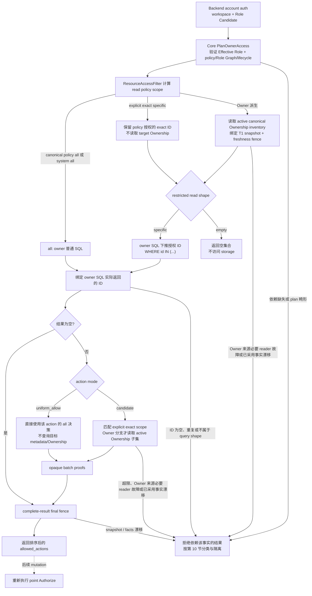

# MOI IAM 请求与运行期合同

内部沙箱图片识别 `POST /api/v1/internal/sandbox/analyze-image` 使用现有
`RuntimeCatalogRequestAuthorizer` 验证 API 身份与 active-task RuntimeGrant 的
workspace/user/task/manifest 一致性并重验任务准入。仅接收有界图片字节和问题，
调用 img_parse，不读取 Catalog 文件、不接受调用方指定模型或凭证、不创建持久化文件。
原图下载独立遵循文件读取授权。该接口不接受普通 API Key 单独调用。

本文是 Backend -> Core 请求授权和异步/运行期身份延续的唯一规范性合同。业务权限模型目录、例外登记和 M6 计划只能引用本文，不得重新定义 transport 语义。

## 1. 四类 Backend -> Core 合同

### 1.0 闭合 execution contract

Backend 的 `coreclient` 负责校验并编码已命名的 execution contract；它不根据直通代理 URL、`coreclient.Execute` 调用方式或任意布尔 header 推断 receiver 的授权模式。认证 principal、request/trace ID 属于可信 transport 边界，下面的 shape 只列授权相关字段。

| contract                         | 闭合字段形态                                                                                                                         | 接收方语义                                                                                                                                                                                                                                                                                                   |
| -------------------------------- | ------------------------------------------------------------------------------------------------------------------------------------ | ------------------------------------------------------------------------------------------------------------------------------------------------------------------------------------------------------------------------------------------------------------------------------------------------------------ |
| 空 contract                      | 仅非授权 identity transport，至多一个 canonical Role 输入                                                                            | 不产生 IAM allow、membership skip 或 runtime skip                                                                                                                                                                                                                                                            |
| `bff_complete_pep`               | workspace、Verified Effective Role、两个 admission boolean 和 canonical action facts；没有 Role Candidate、owner 字段或 continuation | BFF 侧完成业务 PEP 后可携带到下游作审计和链路记录；可信 BFF 调用 Catalog 非数据树时无需该合同，Catalog 不重复校验或创建第二个同业务 PDP                                                                                                                                            |
| `catalog_data_tree_receiver_pdp` | workspace 加恰好一个 Role 输入；没有 admission、owner、action fact 或 continuation                                                   | 专用真实 Catalog 数据树 receiver transport；完整 BFF PEP 也可到达 data owner，但只作为身份/Role 输入，owner 必须屏蔽 BFF trust 并独立执行自己的 Core `Authorize` / `ResourceAccessFilter`                                                                                                                    |
| `runtime_continuation`           | workspace、Verified Effective Role 和已登记的 exact continuation kind；没有 Role Candidate、owner 或 BFF action fact                 | 只允许登记的 Worker sender 在对应调用面产生，用于审计和恢复上下文；Catalog 非数据树 receiver 不校验该 kind、admission 或 Role，不以它产生 allow。`workflow_trigger_task_v1`、`data_dashboard_refresh_v1` 和 `data_asset_state_v1` 都不能成为普通业务或数据资源的 allow |

`PrepareCoreRequestContext` 只准备 authenticated identity、Role input 与链路上下文，既不产生 BFF allow，也不把调用标记为数据树 receiver。只有 `PrepareCatalogDataTreeReceiverPDP` 可以产生显式数据树 marker；完整 `bff_complete_pep` 可以到达数据树 owner，但不产生该 marker，也绝不形成数据树 allow。数据树接收方必须在自己的 Core `Authorize` / `ResourceAccessFilter` 前屏蔽 BFF trust。Catalog 非数据树 handler 不要求 wrapper、`bff_complete_pep` 或 runtime continuation：来源已确认可信的 BFF 调用直接进入业务处理；可选 `data_asset_state_v1` 只作 sender metadata，不能被解释为 allow。

Core 签发的请求级数据树计划必须保留 Verified Effective Role 的原始选择来源与版本。`Source` 描述显式选择或 Default Role 选择，`Version` 是相应选择版本；两者不是复用标记。跨 Catalog 子请求恢复必须保持一致，供 SQL 响应与权限变更恢复合同消费；不得以计划签名或请求 ID 替代新请求的准入。具体生命周期见[请求级授权裁决复用](11-request-authorization-decision-reuse.md)。

### 1.1 对象 CRUD/use

适用于已能解析 canonical data resource ID 的 create/read/update/delete/use/run/operate/manage。该流程只用于 Catalog 数据树或 MatrixOne 数据边界；Catalog 非数据树接口由可信 BFF/内部调用直接承接，不重复执行本流程：

```text
Backend account auth
  -> resolve workspace + Role Candidate + trusted resource/parent
  -> Core Verify Effective Role
  -> forward authenticated principal + workspace + VerifiedEffectiveRoleID
  -> Catalog/Core receiver resolves its actual resource/action
  -> Core Authorize
  -> owner handler
```

create 对父容器授权；其它动作对目标对象授权。Backend 外层 PEP 的 action 决策止于公开业务 route；Catalog 数据树不得将其直接当作自己的数据 allow。Catalog 非数据树不属于新的 IAM receiver：可信 BFF 和内部调用无条件进入，只做必要的 workspace tenant、输入和引用完整性检查，不要求 `bff_complete_pep`。Data Dashboard、Data Asset 内部状态和 Workflow/Runtime 内部状态均不因此形成第二个 Catalog PDP，也不授予逻辑数据树或 MatrixOne 数据权限。

### 1.2 list/search/picker

适用于必须按调用者可见资源过滤的集合：

```text
Backend account auth
  -> resolve workspace + Role Candidate
  -> PrepareCoreRequestContext
  -> Core handler verifies Effective Role
  -> Core ResourceAccessFilter(resource, read/use action)
  -> Core owner service resolves canonical business lifecycle and optional Ownership fact independently
  -> business storage filters before count/order/limit/offset
```

`PrepareCoreRequestContext` 只为 Core owner 的 `Authorize` / `ResourceAccessFilter` 或 Object Grant mutation 转发身份、候选 Role 和链路事实；它不是 BFF complete PEP，也不是 Catalog 数据树的 receiver PDP marker。真实数据树使用 `PrepareCatalogDataTreeReceiverPDP` 的专用 receiver transport，携带 identity/workspace/Role 以及 Core 签发的当前请求数据树计划；receiver 必须屏蔽 BFF admission/facts，精确匹配计划，未覆盖范围再执行 own PDP。Catalog 非数据树 route 不要求该 prepare 或独立 PDP；有权限模型的批量读接口才可按已登记过渡约定使用 `ResourceAccessFilter`。generic prepare 或 direct proxy 都不能自动升级为独立数据资源的 allow。

请求级集合计划传输完整 query shape 和必要来源分类，不传逐资源裁决解释；保留 exact IDs、parent/path 范围与 system Role 区分，不截断范围或提升为点授权。原始 PDP 来源与审计不受传输精简影响，合同大小上限继续 fail closed。HTTP 之外的独立后台操作必须由 owner 创建并关闭自己的授权生命周期，不能沿用已结束请求的计划；A2A 非数据树会话持久化仍遵循可信内部调用合同，详见[请求级授权裁决复用](11-request-authorization-decision-reuse.md)。

集合接口与单对象点查使用不同的拒绝语义。请求结构合法且可信父资源存在时，集合接口只按当前
Effective Role 的 canonical scope 过滤结果；没有任何可见资源时返回 `200` 和空集合（例如
`items: []`、`total: 0`），不能仅因为过滤结果为空返回 `403` 或 `404`。父级集合权限不足也只能产生空集合，
不能把“无可见子项”当成业务拒绝。可信父资源不存在、已删除或无法解析时仍返回稳定的 `404`；Core、
MatrixOne 或其它必要依赖故障继续按服务错误返回 `5xx/503`。单对象点查仍可用 `404` 隐藏调用者无权
访问的对象存在性，不能把点查的存在性隐藏语义套用到集合过滤。

外部 Backend 只把 Role Candidate 交给 Core verifier；完成验证后的 data-tree trusted hop 只保留冻结的 Effective Role，不声称业务 allow。Core route 不得把上游布尔值错误挂载为 `WithCurrentCoreAuthorization`，也不能把普通 Role 的成功业务请求标记或转换成 canonical `all`。

普通 Role 的 point、collection 和 projection 通过同一个 Application Action boundary 解析 Registry requirement，再计算 scope；非 `application_policy` action 不能进入 Owner 派生授权。过滤必须在分页前执行，不能先取一页再隐藏无权对象。canonical policy `all` 物化为 `AllResources`；显式 specific/parent/path grant 物化为对应受限 query shape，这些显式授权都不附加 target Ownership 条件。当前 `OwnerAccessPlan` 只承载 exact specific ID，parent/path collection 由支持相应 query shape 的 owner PEP 消费 `ResourceAccessFilter`。只有 Owner 派生 ID 必须在 owner query 或 Core 完整结果证明中要求 active Ownership；Ownership 缺失或异常既不形成 deny，也不使其它显式 grant 失效。System DB 对象不得引用 Tenant DB 表；普通 Role 当前 scope 必需的 policy、Role、资源层级或数据面事实缺失、异常、预算溢出或读取失败时不得产生可见结果。

当前 Effective Role 的 direct binding、角色真实性和 lifecycle 经 Core 验证后，内置 `superadmin` / `admin` 立即进入 system-role 快通：point 直接 allow，collection 返回 `AllResources`，`OwnerAccessPlan` 返回全量查询与全部 `uniform_allow`。该路径不读取 Registry、Application Policy、Role Graph、target Ownership、资源层级、MatrixOne DCL 或业务元数据，也不在 owner 查询后重复做权限快照校验；业务 owner 查询仍负责 workspace、存在性和自身 lifecycle，实际 MatrixOne 数据访问仍由 MatrixOne 边界执行。

逻辑 Catalog 数据树和其它独立资源 receiver 不复用 `BusinessActionAuthorized`、上游 action facts 或 workspace-owner 标记来生成 point allow 或 collection scope。它们使用收到的 authenticated principal、workspace 和冻结 Effective Role 对自己的 action/resource 调用 Core；system-role 分类只能来自 Core 已验证并绑定当前顶层请求的 Role 事实。单对象决策不能成为 collection 的 `all/specific` 证明。

`moi-core/catalog` 进程不因此把每个 endpoint 都变成独立业务 PEP：Data Asset 的内部 manifest、derivation、parsed manifest、resolve 和 lineage，以及 Dashboard 的非批量读接口，对可信 BFF 和内部调用无条件通过，只做非权限性的输入、租户分区和引用完整性处理；Dashboard list 等有权限模型的批量读接口可保留 `ResourceAccessFilter` 过渡例外。Worker 的 Dashboard continuation 仅是发送端登记的审计/上下文元数据，Catalog 非数据树 receiver 不校验或消费它做 allow。上述非数据树路径都不能向真实 Catalog 数据树或 MatrixOne 数据面扩散 allow。

#### 1.2.1 OwnerAccessPlan 与条件式 action 投影

当 owner list/detail 既要按可见范围查询，又要返回对象级 `allowed_actions` 时，Core 必须在业务 SQL 前生成 request-scoped `OwnerAccessPlan`。该 plan 是尚未完成的多阶段裁决，不是 `BusinessActionAuthorized` 的复用结果，也不是可以跨请求或用于 mutation 的 capability。



Core 输出的 read shape 只能是 `all`、`specific` 或 `empty`。canonical action `all` scope 和已验证 system all-access 都物化为 `all`；同一 scope engine 也必须在 point Authorize 中先识别该 action 的 canonical `all`，不得预查目标 metadata 或附加目标 Ownership。通用 `ResourceAccessFilter` 将显式 specific/parent/path grant 物化为受限 query shape；当前 `OwnerAccessPlan` 只接受其中的 exact specific ID。Owner 派生 scope 从有效的 active Ownership inventory 得到 ID，并绑定 Ownership snapshot。缺失、non-active、畸形、重复或冲突记录不进入该集合，只记录权限元数据异常，不得让显式 grant 或 system Role 的 plan 失败。只有必须计算尚未被其它来源覆盖的 Owner scope、但 reader 本身不可用或已采用的 active 事实发生并发漂移时，才按 Owner 来源依赖错误 fail closed。受限 shape 必须下推 storage，`empty` 不得访问 storage，`all` 由 owner SQL 在分页前执行 workspace、逻辑删除和 canonical lifecycle 过滤。

对显式 exact `specific` scope，Core 输出的 ID 可以直接被所有 PEP 消费，不要求 Ownership。对 Owner 派生 ID，active Ownership 匹配属于 Core 权限计算；支持 Ownership SQL predicate 的 owner 可以应用 plan 中的 active 条件复核并发漂移，但不能重新解释显式 grant、Owner 继承或 action 覆盖关系。

workspace 级 Application Policy generation 是集合快照的宽粒度写入 fence。读取期间 generation 变化时，当前只读事务必须回滚；确认回滚成功后，Core 最多完整重读一次。只有新读取前后的 generation 一致，且本次计算所用 Role Graph、继承 Role lifecycle、Grant Index、MatrixOne SELECT 和各类 Ownership 原始事实与前一次完全相同时，才能以新 generation 计算并返回 plan。此前复用过请求内 primary Role 验证的路径，重读时还必须查询其当前 lifecycle，并核对已验证的 Role generation。相关事实变化、第二次 generation 仍漂移、必要 reader 失败或无法确认回滚时均 fail closed；不重新选择 Default Role，不重放业务写入，不保存跨请求权限结果。

每个待展示 action 的 mode 只能是 `uniform_allow` 或 `candidate`；前者只能来自该 action 的 canonical all scope，后者只投影 SQL 实际返回的资源。显式 exact specific read plan 不保存 Ownership snapshot；混合计划只为已经成功命中的 Owner 派生来源保存完整 active Ownership record。每批 strict exact-ID reader 只校验这些已采用 Owner ID，必须返回同 workspace/type、active、正版本、无 repair state 的精确完整集合，不能退回 point read。普通缺失或异常 Ownership 在采用前即作为 no-match 跳过。canonical `all` plan 直接接受 owner SQL 返回的 ID；某个 action 的 `read.all` 不会让其它 action 变成 `uniform_allow`。

canonical `all` read 返回的资源中，candidate action 仍按各自 scope 独立计算。当前 bounded projection 支持 canonical all、显式 exact specific 和 Owner 派生 candidate；目标没有 Ownership 时显式 exact candidate 仍然有效。parent/path candidate 需要 owner 查询同时返回 canonical 层级，当前 `OwnerAccessPlan` 尚未登记该合同，不能伪造层级。仅 Owner 派生 candidate action 读取 active Ownership 子集并在响应前重读 opaque proof。

owner 只能应用 query shape，并把 SQL 实际结果交回 Core，不能读取或补造 plan 内部 facts。每批最多 100 个同类型资源和 16 个 action；proof 对调用方保持 opaque，最终 fence 必须按顺序精确覆盖完整结果集，并重验 policy、Role Graph、binding 与 lifecycle。只有含 Owner 派生来源的 plan 才对对应 ID 执行 T2 exact read、T3 readback 和 T4 complete-result read/readback；显式 exact specific ID 不进入 Ownership proof。canonical `all` plan 仅在 candidate action 含 Owner 分支时重读 active Ownership 子集。SQL 零行或 detail not found 仍必须通过全局权限快照 fence。

`allowed_actions` 只用于 canonical UI 展示，合法 deny 使用稳定空数组；后续 update/delete/operate 等 mutation 必须重新执行 point Authorize。Core、当前 scope 所需的事实源或 final fence 不可用，以及 plan、资源或 snapshot 漂移均不得产生未经证明的 allow，错误分类遵循第 10 节。

读取授权与附带的动作投影分别确定影响范围：read scope、资源和共同身份仍可完整证明时，某个 candidate action 的可控异常只取消该动作，不得使整个 detail/list 读取失败。隔离由 Core 完成，调用方不能捕获任意 projection 错误后返回空 `allowed_actions`。已经独立完成读取授权、附加提示不参与读取证明的知识库详情，按[知识库展示合同](08-business-permission-model-catalog.md#63-semantic-model)省略不可用提示；不沿用或制造动作 allow。异常影响 read scope、共享 snapshot 或完整结果证明时，不能继续返回相关数据；集合仍遵守完整性、total 与分页合同，不提供未经登记的部分成功。上述 final fence 只需证明实际返回的数据和保留的 allow，不能依赖已排除的异常动作来源来否定其它独立证明。

### 1.3 exact-object grant/revoke

Object Grant 的 Owner 例外和普通授权链必须由 Core 在同一个 mutation 入口判断：

```text
Backend account auth
  -> resolve workspace + Role Candidate + exact target resource
  -> PrepareCoreRequestContext
  -> Core verifies Effective Role + target Role
  -> one lifecycle-filtered Role Graph snapshot
  -> role.create / role.update: allow without reading target Ownership
  -> otherwise read exact active Ownership
  -> Direct/inherited Owner: allow ordinary action grant/revoke
  -> Core validate/apply + policy/lifecycle CAS + audit
```

Backend 只传 Role Candidate，不先做 `role.create` 或 `role.update` 并声称 allow。Core 把 active Ownership 视为该对象全部可授权 Application IAM 操作及对应 grant/revoke 能力的不可拆分集合；Owner 经普通 active Role graph 继承时不要求继承边 WGO。非 Owner 的 Object Grant 由同一 Verified Effective Role 的 workspace `role.create` 或 `role.update` 管理。MatrixOne Data Privilege 委派使用相同五种准入来源，Ownership 仅覆盖同一 exact 对象，物理 WGO 不作为独立 API 准入，SELECT 转授同时允许配置目标 Role 的行列规则；来源组合与范围以 [Table 与 MatrixOne](08-business-permission-model-catalog.md#54-table-与-matrixone) 为准。目标 action、exact scope、grant option 和策略结构仍由 Core 校验，调用者不需要另行持有目标对象的 `*.grant.*` action。

Object Grant 的 Owner 分支只适用于 exact 对象的普通、grantable、Application Policy action；`grant.*` 权限本身、整份 Role Application Policy 管理和 MatrixOne DCL 不在该例外内。目标 Ownership 缺失、non-active、畸形或版本不完整时，只表示 Owner 例外没有命中：有 `role.create` 或 `role.update` 的调用仍可继续，没有该管理权限时按普通未授权返回。只有已经选择 Owner 例外后无法可靠读取或验证其必要事实，或者 Role graph/lifecycle/Registry 等本次实际采用的授权事实不可用时，才按依赖错误 fail closed；不能把 Ownership 状态扩散成整个 Object Grant mutation 的前置 gate。

### 1.4 membership-only

仅用于已在[业务权限模型例外登记](10-business-permission-model-exceptions.md)中确认“不代表产品对象授权，只要求当前 workspace 有效成员身份”的能力：

```text
Backend account auth
  -> RequireVerifiedEffectiveRole
  -> Core verifies unique Effective Role
  -> forward VerifiedEffectiveRoleID
  -> Catalog 数据树 receiver transport
  -> handler
```

membership-only 不能伪造 business action，也不能用 Role Candidate 直接通过。缺少 canonical action 的业务对象不得临时归入本类。

## 2. Transport 事实

Core client 传输的权限上下文必须具备明确来源：

| 事实                          | 来源                                              | 语义                                                 |
| ----------------------------- | ------------------------------------------------- | ---------------------------------------------------- |
| workspace ID                  | Backend 可信上下文                                | 请求所属 workspace，不代表成员关系                   |
| principal ID                  | 已认证账号到 canonical 用户映射                   | Core 验证主体                                        |
| Role Candidate                | 外部显式输入或 Default Role 候选                  | 仅在 Core 验证前作为输入，未验证，不能 allow         |
| Verified Effective Role ID    | Core Effective Role verification                  | 当前唯一有效 Role；受保护 receiver 用它重新调用 Core |
| owner classification snapshot | 创建 durable task/job 时记录的 `IsWorkspaceOwner` | 仅用于审计；恢复时不得重建 allow/skip fact           |
| request/trace ID              | 入口链路                                          | 审计和排障，不参与 allow                             |

签名 transport 防止上下文被篡改，但签名本身不把旧结果变成永久 capability。Backend 对公开 route 的 Core action 决策与 Mowl 保存的入口 allow 都不是跨服务 transport 事实；它们不能被 receiver 解释为自身 action/resource 的授权证明。

**唯一已登记的 Task-continuation sender。** `moi:workflow.trigger -> Catalog POST /api/v1/workspaces/:id/tasks` 延续已经由 BFF -> Core 入口按该业务 Task 的 `workflow.run`（或对应入口业务 action）完成的执行上下文。发送端只能使用专用 `GetForTaskContinuation` 产生 `runtime_continuation` / `workflow_trigger_task_v1` 元数据：冻结的 canonical actor、workspace、Verified Effective Role，以及两个 admission boolean（`WorkspaceAccessVerified=true`、`BusinessActionAuthorized=true`）；该元数据必须没有 Role Candidate、`IsWorkspaceOwner` 或 `AuthorizedActionFacts`。Catalog Task 是非数据树接口，对已确认可信的 BFF/内部调用无条件信任，不校验 continuation 或再次调用 Core；仅执行 Task/`workflow_version_id` 的业务输入和事务完整性检查。上述 admission boolean 只供审计和运行上下文记录，不能成为 owner bypass 或其它下游资源 allow。该 sender 约束不是签名 capability 或 `RuntimeGrant`，不新增 Registry resource/action；普通 worker client、裸 `task_id`/`case_id` 或 system credential 单独出现不会获得任何额外 allow。当前唯一生产调用点是 `moi:workflow.trigger` 的 `WorkflowTrigger`；其它 WorkItem 不得接入该专用 client。Role revoke 或 Core outage 不会在这个非数据树 child-Task 创建点额外判定；后续 Volume/File/Connector/Table/Database/MatrixOne 等实际数据资源访问仍必须按各自 canonical resource/action 调 Core 或按 MatrixOne data contract fail closed。

### 2.1 Role Candidate 生命周期

在一次 Backend workspace membership 校验中，`RoleCandidateID` 与 `VerifiedEffectiveRoleID` 分别表示验证前后的不同阶段：

| 阶段                                | `RoleCandidateID`                          | `VerifiedEffectiveRoleID`           | 约束                                                               |
| ----------------------------------- | ------------------------------------------ | ----------------------------------- | ------------------------------------------------------------------ |
| Backend 外部入口                    | 可包含调用方提供的 Explicit Role Candidate | 为空                                | candidate 只作为 Core 输入；缺省时由 Core 按 Default Role 合同选择 |
| Core 校验调用                       | 原样传入候选                               | 为空                                | Core 校验 principal、workspace、direct binding 和 lifecycle        |
| 校验成功后的同一 Backend 请求上下文 | 清空                                       | 写入 Core 返回的唯一 Effective Role | 后续 PEP、handler 和请求级复用只消费 verified fact                 |
| Core 校验失败                       | 不产生可继续处理的可信上下文               | 为空                                | 保留 Core 错误分类并 fail closed，不回退 Default Role              |

Core projection 响应中的 `explicit_role_id` 是本次裁决的只读展示与审计结果，不是 Backend 校验后请求上下文中的可信 Role。Backend 不得用它重新填充 `RoleCandidateID`，也不得在校验后用入口 candidate 代替 Verified Effective Role 绑定 projection、授权结果或业务处理。

业务 handler 也不得通过读取已清空的 candidate，把空 `role_id` 传给后续 Core 请求并重新选择 Default Role。公共 context 应提供不可变的 Verified 身份，IAM adapter 从该身份同时构造 acting Role body 与执行 header，Core 接收端检查二者一致；`target_role_id` 等管理目标不参与这种自动构造。具体类型、错误和门禁见[请求身份与统一准入](12-request-principal-admission.md)。

统一准入的目标是让首个 `Authorize` / `ResourceAccessFilter` / owner plan 同时返回最小身份事实与本次结果，避免普通业务入口先查询完整成员/角色展示投影。需要提前解析 Backend-owned parent 的路径使用独立轻量身份验证，不允许未验证 membership 就读取 tenant 业务内容。该机制尚未全面实现，当前缺口见[实现状态](05-implementation-status.md)，发布与 middleware 顺序见[迁移计划](plans/request-principal-admission.md)。

复用生命周期是一次顶层 BFF 请求，覆盖该请求的多个 Catalog 子调用。Core 首次产生的 Verified Effective Role 在该请求中最多验证一次；数据树按 actor、workspace、Role 和精确 canonical resource/action 匹配 Core 专门生成的授权计划，未覆盖范围批量补充后继续复用。普通 BFF allow 与 Mowl durable context 不进入数据树计划。当前分进程合同使用活跃 BFF 请求实例与 Core 签名计划，未来可直接使用进程内 request context，见[请求级授权裁决复用](11-request-authorization-decision-reuse.md#顶层-bff-请求的数据树计划)。

Catalog 仅在实际读取/写入逻辑数据树（`Catalog -> Database -> Volume -> Folder/File`、`Table`）或进入 MatrixOne 数据面时成为独立数据边界。数据树门禁匹配 Core 的请求级精确计划，miss 才进入 Core PDP；同一顶层请求内已经覆盖的操作不重复读取 Role、Policy、Role Graph 或 Ownership。文件以 canonical Root Volume/action 去重，Admin/SuperAdmin 在确认可信 Verified Effective Role 后直接得到全量范围。`BusinessActionAuthorized`、业务 action facts、owner 标记均不能生成数据树 allow。计划请求结束失效，不能存到 Task 或跨请求缓存；首次门禁和补充失败关闭，已覆盖门禁不因 PDP 短暂不可用而失败。

文件、文件夹及卷的 `volume.read/write` 产品 PEP 通过 `POST /api/v1/system/workspaces/:id/volumes/prepare-authorization` 向 Core Volume owner 一次提交文件、文件夹或 Data Asset 标识，以及服务端绑定的 `volume.read/write`。输入最多 1000 个标识；普通 Role 由 owner 分段读取 containment、按 Root 去重后提交一个批量 PDP。Admin/SuperAdmin 在可信 Role 确认后跳过全部权限准备读取。BFF 不再逐 Root 先执行普通业务 Authorize；成功响应必须是 HTTP 204 和一个有效、匹配当前请求的签名计划，之后才进入业务 handler。该内部接口要求活跃 delegated BFF 请求，不能用于 Task continuation 或 system principal。

准备失败不发布 allow，稳定 reason/domain 保留在 Core 错误合同中。合同身份不匹配返回 403；缺失、损坏或不匹配的 Core 准备响应由 BFF 返回 502；依赖不可用返回 503，超时返回 504。日志保留失败阶段、资源/action、身份、request/trace 及原始 error chain，公开提示不携带内部诊断或计划内容。

Data Asset 的 manifest、derivation、parsed manifest、resolve 和 lineage 是内部实现状态，只处理可信 BFF/内部 transport 下的输入、租户分区和引用完整性；Dashboard `execution-spec`/`evaluate-alert` 对可信 BFF 和内部调用无条件进入，不要求完整 `bff_complete_pep`，也不重跑 Dashboard PDP。Worker continuation 如存在，只能由登记的 sender 使用 `data_dashboard_refresh_v1` 元数据，Catalog 非数据树 receiver 不校验它。它们不因此取得 Catalog 数据树、source Table 或 MatrixOne 数据权限。

创建 API Service 等需要访问多个 dependency 的路径，BFF 先完成产品 action allow/deny；Catalog 非数据树业务接口信任已确认的 BFF 调用并执行自己的业务写入，不重复调用 Core 组合 `api_service.publish`、`custom_operator.use` 或 `compute_resource.use`。若后续实际触达 Catalog 数据树或 MatrixOne，数据 owner 再按自身资源合同调用 Core；通用 Backend admission 不能替代这些数据边界的 allow。

## 3. App Shell Current Principal Bootstrap

`POST /newmoi/user/info` 是当前前端首屏权限上下文入口。Backend route middleware 通过一次 Core `CurrentPrincipalAccessProjection` 得到并复用同一份 projection，响应同时包含：

- 展示用用户信息；
- `iam_context` 中的候选、Effective Role、Role 状态与版本；
- `iam_capabilities`；
- `iam_snapshot_version` 和 request/trace ID。

projection 缺失、与当前 account/workspace/request/trace 不一致、projection 返回的 Effective Role 与请求上下文中的 `VerifiedEffectiveRoleID` 不一致、Role context 未 ready，或 workspace 校验成功后的 Backend 请求上下文仍残留 `RoleCandidateID` 时必须 fail closed；未 ready 的上下文不能扩展为业务 capability。projection 自身返回的 `explicit_role_id` 可以用于响应展示，但不能参与校验后的 projection 复用判断；该判断必须使用同一 projection 返回并经 Backend 接受的 Effective Role。Frontend request client 独占 `X-MOI-Role-ID` 注入，页面和业务调用方不得自行设置该 header。

App Shell 不得恢复串行 `/me/roles` 加 `/me/capabilities` 作为主链路，也不得把 `permissionCodes`、`objPermissions` 或菜单配置暴露为 allow 事实。显式切换候选 Role 时先清空旧 context/capability，再重新 bootstrap；详细公开语义见 [公开 API、前端与 SDK 合同](07-public-api-frontend-sdk-contracts.md)。

### 3.1 Native 内部能力读取范围

`GetCurrentPrincipal` 保留 UI bootstrap 的完整成员展示与能力投影；内部 `GetCurrentPrincipalCapabilities` 在 Role 解析后重新读取 canonical workspace/member 生命周期，不为权限提示加载 tenant alias、tag 或 Member 展示投影。其内部查询的 `CapabilityIDs` 为 `nil` 时投影完整已登记清单；非空选择按 ID 去重并排序，只投影已登记的请求项，未知 ID 在 `unsupported_capability_ids` 中去重、排序后返回；显式空选择只验证身份与唯一 Effective Role，不产生业务能力项。空选择及全部 ID 未知的请求仍进入 Core 的身份验证，不能成为匿名、失效成员或候选 Role 的放行路径。该内部选择不改变 Product SDK 的 bootstrap 响应。

### 3.2 Agent Builder 沙箱 CLI

`POST /workspaces/{id}/agent-builder/runtime` 是当前活跃任务内的 authoring transport，使用既有沙箱任务凭证恢复唯一冻结 Role，验证调用工作区、用户、任务、manifest、executor 和当前 `agent.use`。任务必须已准入 `agent_builder` 能力；命令参数不接受调用身份、Role、任务、会话或编辑目标。读取上下文、导出资源和提交均从服务端任务输入及候选事实解析创建或准确目标修改，继续经过生成的 `agent.create` / `agent.update` 边界。集合元数据继续由各资源 owner 的 Core collection filter 限定，读取目录不授予执行或绑定权限。

CLI 的 `context` 与 `resources` 读取不写候选。`propose` 和已发布 MCP 入口复用原生工具调用收据与候选 mutation；同一任务、同一规范化提交使用稳定 call ID 重放，不能用新身份或另一写路径自动重试。CLI 提交产生与原候选相同的 canonical conversation projection，最终发布仍经现有用户确认 API。

## 4. 外部与内部角色选择边界

- 只有 Backend 外部请求可以携带 Explicit Role Candidate。
- Product SDK 包装 Backend；只有在公开强类型参数已发布时才能传递候选。当前通用 custom-header escape hatch 不是 Explicit Role 合同，Core SDK 也不是 Product SDK 的替代品。
- Core 验证候选后，将唯一 Effective Role 固化进 durable task/runtime context。
- Worker、WorkItem、Mowl 和其它内部执行方不提供第二次 Role 选择，只消费 `ExecutionContext.EffectiveRoleId`。
- 内部任务不得从 Default Role、全部 bindings、service account 或 system owner 重新解析 Role。
- `ExecutionContext.EffectiveRoleId` 是 Task 全生命周期及其所有下游受保护调用的唯一 Role 输入。接收服务重新鉴权时读取并校验的是该精确 Role ID 的当前 membership、direct binding、Role lifecycle 和 policy facts，不是重新选择所谓“当前 Role”或“最新 Role”。接收服务不得重新读取 Default Role、从其它 direct binding 选择替代 Role，或执行 Role union。该 Role 不再有效时 fail closed；切换 Role 必须经过新的外部入口鉴权并产生新的 execution contract。

## 5. Durable execution context

跨请求、进程或服务的异步操作，在首个外部副作用前持久化共同的恢复事实：

- workspace ID；
- canonical principal/runtime actor；
- Verified Effective Role ID；
- 创建时的 owner classification（可选，仅用于审计）；
- operation/task/request/trace ID；
- canonical resource 与 dependency IDs；
- payload hash 和幂等版本；
- 审计所需的可信快照；
- 需要恢复外部事实时的加密凭据或等价 durable intent。

持久化 Effective Role 只固定“以哪个 Role 执行”，不冻结其后访问受保护依赖的 allow。任务在实际读取文件、Volume、Connector、Table、Agent 或其它受控资源前，必须让 Core 重新验证该精确 Role 的当前 binding/lifecycle 并执行相应 action。创建时 owner classification 可以随 actor/Role 保存用于审计，但恢复时不得据此设置 `IsWorkspaceOwner`、`BusinessActionAuthorized`、`WorkspaceAccessVerified` 或其它 allow/skip fact；历史记录缺少 actor/Role 时不得从当前异步上下文 adopt。

Mowl Task 还要持久化创建入口的 business action allow 结果。这个布尔值只属于 Mowl 内部运行时延续，不应被其它 durable Saga 或下游受保护服务解释成可复用授权。

Mowl 如何冻结、恢复和注入这些事实，由 [Mowl 运行期执行上下文](../../moi-core/docs/workflow/RUNTIME_EXECUTION_CONTEXT.md)维护。哪些动作属于同一 Task 的内部延续、哪些动作形成新的外部受保护请求，统一按[请求级授权裁决复用](11-request-authorization-decision-reuse.md)判断；其它文档不得复制场景表或把 durable allow 扩大为跨服务 capability。

与 Mowl durable allow 不同，Astra Agent 在 A2A 准入对真实 Agent 执行一次 `agent.use` 后签发 task-scoped `RuntimeGrant`。Catalog Model Gateway 是内部模型调用 capability interface，只验证该签名 grant 与冻结的 task/manifest/binding/selected model 范围，不重新读取 Role、tenant `TransactionManager` 或 Core PDP。该 grant 不能从 Mowl durable allow 推导，也不能扩展为 Volume、Workflow、Connector 或其它受控资源的 allow。

显式声明 `foundation_ref=momo` 的 Agent 在本轮准入时将当前 MOMO 的 Skill/Tool 规范引用与自身扩展做并集去重，随后应用显式 capability ceiling 并冻结到同一 Manifest/RuntimeGrant。知识库操作说明的 Skill 可读性不要求已选择知识库，也不授予知识库数据访问；真实 Knowledge Base、文件和表操作继续受原有 scope 与 PDP 约束。基础模型、知识库、渠道实例及凭据不随成员并集继承，已冻结任务不因基础成员更新而扩大范围。

工作区 Agent MCP 入口先验证普通产品身份，再从 `X-MOI-Runtime-Authorization` 读取同一 live task 的签名 grant。业务 owner 验证 working task、冻结 manifest、路径中的 workspace/Agent 与已认证的 canonical actor 一致，并沿用当前 task admission；该 header 不替代产品身份，也不扩大 task 的工具范围。

显式选择 managed `sbx-*` 或 `runner-*` 时，MOI 通过 provider 签名请求中的 `edge_workspace` 与
`edge_agent` binding 选择执行器；Astra Edge 将同一 task 的 RuntimeGrant 注入 bash 子进程。
managed Sandbox 的 `moi-cli` 保留 provisioned Edge token 与原 task proof。既有任务身份
入口校验两份签名、live working task、冻结 actor/Role/manifest/executor、当前 JTI 与撤销状态，
再由身份 owner 内部复用 UC PAT resolver，并通过 UC introspection 认证 canonical 账号。
Edge token 本身不产生 Product principal；PAT 不返回调用方、不放入请求头、context、日志或响应，
也不重签 task proof。UC 认证后重进 Agent 与冻结执行器的正式 use 边界，恢复原任务 Role；
目标资源仍执行自身的当前 PDP。失效证明、完成任务、撤销执行器或 UC 不可用均拒绝。
未选择执行器时，Astra 仅暴露 MOI MCP bash；Catalog 在实际调用时验证 working task、当前 admission
及用户/workspace/context，再通过 Backend 既有 provisioner 创建或复用 conversation-bound `eph-*`。
等待就绪后必须再次验证 task admission。Backend 校验 reservation 的用户和会话归属，通过 OpenShell
执行命令，仅在该命令期间续租，并将 live RuntimeGrant 作为
`MOI_RUNTIME_AUTHORIZATION` 环境变量交给 `moi-cli`。该凭据不进入模型工具参数、日志或
durable dispatch；需要它的 `bash` 只能由持有 live context 的连接执行，relay/replay 缺少凭据时必须
fail closed。三类执行器的生命周期与 `agent_sandbox.use` / `agent_runner.use` 重验仍遵循各自合同；
conversation eph 与本地会话中，单次 Bash 的子进程凭据复用 RuntimeGrant signer 的 active lease，仅由该命令持有，并在命令成功、失败或取消返回时释放。签名中的短期 expiry 与冻结 scope 不变；到期后的使用只在同一命令仍存活时有效。每次产品请求仍验证 working task、manifest、actor/Role 和目标资源当前授权，不能把命令租约解释成业务 allow 或向后续命令延续。
文件传输与 artifact 发布统一使用 `moi-cli`。
已绑定的 conversation eph 在当前 Bash 准入内同时提供 Astra 原生 `read_file`，用于读取同一
`/sandbox/.moi` 工作区并产生写入后的可信观察回执；显式 policy 不允许 Bash 时不绑定该执行器，
也不提供此文件工具。该投影不改变冻结的 MOI manifest，不扩大 Catalog、Volume 或跨会话文件权限。
RuntimeGrant 的 `allowed_tools` 是冻结的 MOI manifest scope，不描述 Astra Edge 内置工具。Catalog
先要求当前请求的认证用户与 grant 一致，再验证 task/manifest、working 状态、用户/workspace
一致性，并重新执行 task admission。通过后它只恢复该请求的 Verified Effective
Role 候选；Catalog 的每个 Database、Volume、File 等 handler 仍必须以该 role 调用 Core 完成
实际 action 的 allow/deny。RuntimeGrant 不是通用 Catalog API 的 product-action allow，也不能
替代文件、Volume 或其它资源的 live authorization。

知识库创建、来源追加、本地源文件上传、model/source/job 查询复用上述 active-task 身份恢复链路。Custom Operator 的 list、create、detail/source、update、test-run 同样恢复该任务冻结的身份，并由正式 Workflow/Custom Operator 生成边界重新执行当前业务权限。任务身份只恢复冻结 Role 候选，Knowledge 正式生成边界继续按 `semantic_model.create/read/update` 和源 Volume/Table 依赖裁决，不新增本地 allow、默认 Role 或 system principal。执行工作区的模板、平台 Skill 和工具制品由 MOI 发布包准备，不包含凭据，也不形成业务资源访问授权。

会话 CLI 使用的工作区产品接口统一复用该 active-task 身份恢复入口，包括 Catalog、Connector、Workflow、Knowledge、Dashboard、Data Share、Compute、Agent、Skill、Channel、Plugin、Member 和 IAM。接口存在 CLI 命令时，不能仅因携带合法任务头而在传输层拒绝。业务创建、修改、运行和集合过滤仍进入原有正式生成边界，按冻结 Role 的当前 binding/lifecycle 和业务 action 判权。

Native `moi` 的普通产品 API 统一使用 `requireIdentity`：无任务凭证时验证原有产品身份；携带任务凭证时，在同一身份入口验证账号、签名、live task、workspace、manifest 和任务指定的 Role。路由不再逐个选择是否接受任务请求；凭证无效时拒绝，不能移除任务头或改用用户默认 Role。任务产物发布和图片分析等必须携带任务凭证的专用协议继续执行各自的准入要求。
MCP 内部转发必须保留原 `X-MOI-Runtime-Authorization` 并重新进入目标身份入口；不得移除任务头后使用用户默认 Role，也不得复用外层请求的已缓存授权事实。目标 workspace 与原任务不一致时拒绝，并返回稳定错误码 `ErrRuntimeTaskWorkspaceMismatch` 和本地化提示，要求进入目标工作区新建会话；不得把这种拒绝归为目标工作区缺少成员或 Role。
成员与 IAM 操作沿用 workspace member、Role 和资源授权的正式边界；渠道、连接与插件由各自 owner 校验凭据、归属和当前 use/configure 权限。任务头只恢复请求身份，不构成业务 allow；完成、撤销或无效任务不得继续请求。
自动化任务沿用 `agent_resource.automation_task.*` 和 `agent_resource.automation_run.*` 的现有
操作合同：任务管理与运行记录读取要求当前有效的 regular workspace 身份，手动运行按任务
owner 解析的目标 Agent 执行 `agent.use`。任务身份不新增独立的自动化权限、不扩大冻结
manifest，也不把当前会话凭据保存为未来自动化的执行身份；后续调度仍由原 Workflow/Agent
运行期 owner 恢复其持久身份并校验实际依赖。

现有 Workflow 候选 `test`、`submit` 接口的工程文件模式只接受上述已验证的 live task：workspace、user、task、context 和 Role 来自 proof，客户端工程文件不能提供身份。Workflow 正式边界重新检查 `workflow.create` 后执行原编译/测试/提交；服务端结果进入同一任务日志的产品事件，候选终态流程重新比对工程 digest 并读取实际测试证据。事件记录没有公开写入接口，不把原工具准入、Bash stdout、可编辑报告或客户端测试状态当成授权或通过事实。
传输层只把 `/workspaces/{id}` 中的 `id` 作为 workspace 路径事实，必须与
`X-Workspace-ID` 和任务冻结 workspace 一致。Connector、Data Asset 等资源路径中的同名
`{id}` 是资源标识，由对应 owner 解析和判权，不能当成 workspace。账号、登录和工作区切换
入口不接受任务身份。会话 CLI 沿用 SDK 的请求作用域：账号级请求不携带 workspace/Role 头，
CLI 同时移除任务头，仅使用原有同一用户 PAT 调用账号入口；工作区请求保留任务头，交由 MOI
验证任务、workspace、Role 和业务权限。CLI 不按这些请求头额外阻断请求，也不维护接口白名单；
账号调用不切换会话的工作区，不在任务鉴权失败后移除凭据重试。

已安装的个人 CLI 插件使用同一个用户的 `eph-*`。实际执行原生 Bash 前，Plugin 的正式生成边界按当前
`plugin_installation.use`、`plugin_connection.use` 集合过滤和冻结安装事实选择可用账号，再由 Connection
的正式 use 边界解密该账号的凭证，交给 Sandbox 写入该用户 eph 的 CLI 配置目录。凭证不进入模型参数、
Skill 内容、运行事件或日志；数据库中的长期副本由 Connection 加密保存。用户自己的普通 bash 可以读取
这些文件，这是向该用户运行环境交付外部账号凭证，不是为某个 CLI 进程新增隔离或每条 shell 命令的 Plugin
授权代理。文件随 eph 原有生命周期回收，不跨用户或工作区复用；外部服务仍执行自身账号权限。CLI 更新的
凭证通过 Connection 的原 generation/revision CAS 保存，不合并旧授权、不重放外部操作。

远程插件的 MCP Apps 复用任务现有资源读取和交互入口。绑定只来自同任务、同 provider run 的可信调用收据及 Plugin owner 持久化的选定工具索引，不接纳模型返回的 URI；app-only 工具保留在该索引内，但不进入模型候选。浏览器携带服务端派生的任务内 App origin ID，回调只能选择同一组件索引内声明 app visibility 的工具。资源读取和回调均使用当前请求用户，重进现有 `agent.use`、`plugin_installation.use` 与所需 `plugin_connection.use` 边界，并在实际发送前核对当前任务、安装/连接绑定及真实工具描述。完成任务可以继续加载其 App，失败、取消、拒绝及绑定变化继续拒绝；索引和收据都不是 durable allow，也不创建新的 URL 代理、凭据 owner 或 stdio 宿主。

扫码或设备登录也通过同一个 Sandbox owner 预留 eph。聊天安装使用真实对话上下文；资源中心直接安装
使用该工作区中该用户的固定授权上下文，不创建业务会话。授权进程使用 eph 内独立的临时配置目录；完成或取消
只清理该目录，不能删除共享 eph。eph 的配额、空闲回收、硬超时和故障恢复仍由 Sandbox 唯一生命周期管理。
所有进程打开、凭证传输和授权状态存取都经过 Sandbox 的正式生成边界。首次打开登录程序时，Sandbox
依据持久预留校验 actor、工作区、上下文及远端 runtime 名称和 ID；冷建 runtime 还通过
`Directory.Profile` 将 actor（可能是 IAM alias）解析为后端 UID，与远端 `user-id` 标签核对；暖池则核对
已领取的 reservation 来源和池标签。导出、状态查询和清理只读取现有运行态，不能重新预留 eph。
登录取消先持久写入该 attempt 的 `Closing`，再由 Sandbox 依据该行冻结的 actor、workspace、会话、程序 pin
及远端 runtime 名称与 ID，精确查询记录的远端并核对 ID 及冷建工作区/会话或暖池形状，不重取
`Directory.Profile`，也不把 actor alias 与后端 UID 标签直接比较；这仅用于该 attempt 的收尾，不构成新的
插件使用准入。随后对该 attempt 的登录进程执行启动 fence 与
进程组 stop-and-join；只有远端回执证明进程已结束，或对记录名称的远端查询明确返回 404，才能删除该 attempt
的私有 home 并确认 `Closed`。本地 stream EOF、
登录超时或 eph reservation 丢失都不是进程终止证明；结果不明时保留 `Closing` 供原 owner 或重启后的 owner 重试。
该收尾不重新预留 eph、不删除共享 eph，也不授予普通主体绕过 reservation 的数据访问能力。

受限轮次可以在 `runtime_capability_policy` 中显式声明布尔值 `managed_artifact_publish`，
它与必填的 `allowed_tools`、`allowed_skills` 独立，不因允许 `bash` 自动开启。policy 存在时，
字段缺失或 `false` 均禁止发布；`true` 只允许进入既有 task、身份与 Volume 授权检查，不能代替
`agent.use` 或 `volume.write`。非布尔值拒绝。整个 policy 缺省时保持原有 Agent 默认行为。
该声明冻结在原 task manifest，primary grant 与 child grant 从同一冻结事实派生；已有受限
manifest 缺少字段仍禁止发布，恢复或 regenerate 不从新请求补出能力，source repair 始终禁止发布。
发布能力缺失保留 HTTP 403 与 `runtime_artifact_upload_denied`，并返回
`details.reason=managed_artifact_publish_not_allowed` 和安全本地化消息。
新增字段应在服务端支持后由调用端启用；旧服务会拒绝含该字段的 manifest，回滚不会静默扩大权限。

受控 Edge 的终产物上传使用独立的 `managed_artifact_publish` task-scoped capability；它不写入
`allowed_tools`。`moi-cli file upload --publish-artifact` 调用受限的 runtime artifact 入口，Catalog
重新验证 active task、当前 admission、认证用户/workspace 与 frozen Effective Role，再对用户私有
Catalog Volume 的 `volume.write` 执行 live authorization。文件持久化成功后由 Catalog 直接向同一
task/context 追加幂等 artifact event；Edge 和 Astra 不接收文件字节，也不生成 artifact 事实。
私有 Volume 首次创建必须先完成父 Database `database.create_volume` 和新 Volume `volume.write` 校验，
再在 tenant 事务内提交业务 Volume；业务提交后以同一 Verified Effective Role 单次幂等登记 Direct
Ownership。Ownership 登记失败只记录完整上下文，不回滚或隐藏业务 Volume。Artifact 上传只接受
持有有效 RuntimeGrant 的 working task；Catalog 在读取上传正文前完成 task admission 与
`volume.write` 校验，然后先在 tenant 事务中持久化零引用 FileMetadata 与上传计费事实，作为后续
不可变对象写入的 durable owner。对象写入或 placement 中断时，同一身份可幂等重试；长期未完成的
零引用记录由既有 orphan-file collector 删除对象、元数据并冲销计费。完整私有 Catalog 文件持久化后
再追加幂等 artifact event。只有两步都
成功时命令才报告交付成功。若文件已经持久化而 artifact event 因 task 终态竞态或依赖失败未能发布，
命令明确失败，但该文件作为已完成 placement 与计费的普通私有 Catalog 文件保留；Catalog
不在终态后恢复上传、不延迟 terminal，也不声称 Artifact 已交付。同一 working task 内重试使用稳定
文件与 Artifact 身份幂等收敛；task 已终态则拒绝且不读取请求正文。
附件下载使用普通 `moi-cli file download` 文件入口，并对文件所属 canonical root Volume 执行
`volume.read`；沙箱内文件只是 executor-owned 本地副本，不是新的 Catalog capability。

另一项已登记的短期数据面 capability 是 Catalog 文件给外部模型拉取的 HTTPS URL。签发入口是
`POST /api/v1/workspaces/{id}/files/{file_id}/model-url`：调用方必须持有当前 Verified Effective
Role。签发 PEP 复用 `authorizePrivateFile`：仅当文件落在系统私有 Catalog hierarchy 时解析
private Volume 并对该 Volume 执行 `volume.read`；普通 Volume 文件在私有 hierarchy 中找不到
对应 Volume 时不额外调用 canonical-root `volume.read`。这条入口不是用户 download，生产调用方
是 worker 在 document-visual 图像 embedding 路径上向 Catalog 签发。数据面是
`GET /api/v1/catalog-files/{file_id}/content?capability=`：调用方是外部模型 provider，没有 MOI
actor、session 或 Effective Role。PEP 只验证 HMAC 签名、`file_id` 绑定和过期时间，不恢复 Role，
也不再执行 `volume.read`。范围限于单文件、HTTPS 和固定 TTL。过期、签名无效或 `file_id` 不匹配
一律 404。角色解绑或禁用影响下一次签发，不撤销已签发且未过期的 URL；这与 Model Gateway
`RuntimeGrant` 相同：权限变更不中断当前已签发的短期数据面。该 capability 不能当作用户
download、preview、stream 或 runtime-files 传输，也不能扩大到其它文件、Volume、Workflow 或
Catalog API。MOI actor 仍走 live `volume.read` 的路径不得改用本 URL。

workflow 文件给内部解析进程下载使用另一项短期数据面 capability。签发入口是
`POST /api/v1/system/workspaces/{id}/workflow-files/{file_id}/download-grant`。调用方是
go-worker，必须携带系统 key 和本次活着的 execution assignment。签发 PEP 与
`DownloadWorkflowFile` 相同：恢复执行身份后按该文件的 `volume.read` 事实授权。数据面是
`GET /api/v1/workflow-file-grants/{file_id}`，请求头只有 `Authorization: Bearer`。
token 是 HMAC，绑定 workspace、这一个 `file_id` 和过期时间，不是系统 key，也不是用户
key。GET 只验证签名、文件绑定和 TTL，不接受系统 key，也不恢复 Role。过期、签名无效或
`file_id` 不匹配一律 404。权限变更影响下一次签发，不撤销已签发且未过期的 token。
这条 capability 不能代替 worker 自己的 workflow-file 下载，也不能代替 Catalog 文件的
model URL。

产品前缀下的同一工作区 `model-url` 签发入口保留已认证任务子进程的访问合同：合法 UC
API key 或上述 managed 双证明，经 UC 认证、活动任务、manifest 与 `agent.use` 验证后恢复冻结 Role，再进入
文件 owner 的归属/挂载授权。普通 Product 身份仍走原账号认证。签名内容入口不挂普通
Product 认证；外部模型没有账号凭证，合法 capability 是该已登记数据面的唯一访问依据。
CLI 空 capability 或字面值 `download` 均不构成有效签名，不能因携带任务身份放行。

会话浏览器使用独立域 `moi-browser-token-v1` 的 60 秒 HMAC 身份票据，将已认证请求的 workspace、user、task、principal 和 Role candidate 绑定到 WebSocket 握手。签发前必须验证任务归属、冻结 Bash 准入与当前 `agent.use`。票据仅恢复调用身份，不保存任何业务 allow；握手和连接每 30 秒经正式身份边界及 owner 重新授权，最长连接 10 分钟。数据面为 `GET /workspaces/{id}/agent-runtime-tasks/{task_id}/browser/stream`，票据只放入 `Sec-WebSocket-Protocol`，不放 URL；Origin 必须同源或在现有沙盒终端允许列表中。路径不匹配、签名无效、过期均拒绝，权限撤销后关闭连接。登录输入只经过该私有输入流，不进入模型、工具参数、日志、产物或会话检查点。浏览器 profile 属于当前 workspace/user/context 沙盒生命周期，不能恢复为后续任务的授权凭据。执行目标来自任务冻结清单；managed `sbx-*` 经正式 Sandbox 边界重验当前 `agent_sandbox.use`，不读取或创建临时 reservation，也不允许失败后切换执行器。两类沙盒的进程工作目录均按 workspace/user/context 派生，常驻实例不等于共享浏览器登录态。

另一项已登记的数据面 capability 是已发布 Agent Web 应用的公开链接 token（PRD V1.3.0 静态方案，替代早期
HMAC 匿名凭证设计，见 `docs/design/agent-public-webapp-design.md`）。入口是公开路由
`POST /api/v1/public/webapp/resolve`，调用方是匿名访客浏览器，没有 MOI actor、session 或 Effective Role；
发布记录按 `(workspace_id, agent_id)` 主键 per-workspace 存储：同一 Agent 可被多个 workspace 各自发布，
包括 `agent_workspace_id = system` 的系统 Agent（设计见 `docs/design/agent-public-webapp-design.md` §8）。
resolve PEP 先按 agent_id 枚举全部候选，再对选中记录校验 `enabled=true` 且请求 token 与其明文 token 恒时相等
（`subtle.ConstantTimeCompare`），不执行任何 canonical resource/action 授权。token 是 `crypto/rand`
生成的 32 字节 URL-safe 不透明串，无过期、无刷新端点；rotate 是唯一的吊销手段，旧 token 立即失效；
停用发布不销毁 token，重新启用恢复原链接。resolve 失败语义防枚举：一律 HTTP 404，仅当记录存在、token
精确匹配但 `enabled=false` 时 body code 为 disabled(16)，其余（记录缺失、token 不匹配、格式非法）一律
unavailable(3)。resolve 通过只产生「可访问该 webapp」的入场事实，绝不进入权威 identity Context，也不能
扩展为任何 canonical resource/action 的 allow；终端对话的 `agent.use` 业务准入（M3 里程碑接入会话链路时）
始终由发布方 workspace 与冻结身份经唯一 PDP，token 事实不参与 allow/deny。冻结身份是发布、enable 与
rotate 时捕获的发布方 workspace 当前 owner 快照（owner principal + `workspace_owner` privilege class，
不携带 Effective Role）；恢复调用身份的合法形状为「个人快照（principal + Effective Role）与 owner 快照
（principal + owner privilege class）恰居其一」，两者同设或同空均 fail closed。`agent.use` 每次请求按
当前 canonical facts 裁决：发布者离开 workspace 或角色被撤不自动失效，workspace 易主或 owner 降级后旧
链接自然失效。token 不写入日志或审计业务
字段，审计只记录 enable/disable/rotate_link 操作类型与资源 ID。

另一项已登记的短期数据面 capability 是已发布 Agent Web 应用的匿名终端用户 session 凭证
（<https://github.com/matrixorigin/matrixflow/issues/20120>，设计见 `docs/design/agent-public-webapp-design.md`
「终端用户身份」节）。签发入口是公开路由 `POST /api/v1/public/webapp/session`：调用方是匿名访客浏览器，
没有 MOI actor、session 或 Effective Role；签发 PEP 复用上段 resolve 的全部准入（发布记录存在、
`enabled=true`、链接 token 恒时相等、冻结身份在场），不执行任何 canonical resource/action 授权。签发产物是
HMAC-SHA256 签名凭证 `wse1.<base64url(end_user_id)>.<base64url(jti)>.<base64url(exp_unix)>.<base64url(hmac)>`，
jti 为每次签发生成的 16 字节 CSPRNG 随机值（refresh 同秒换发也必然产出新凭证），MAC 覆盖
purpose、workspace_id、agent_id、end_user_id、jti 与 exp，固定 TTL 604800 秒；MAC 绑定 workspace_id
前签发的旧凭证一律 fail closed，访客重新进入时自动重建会话，end user 记录与对话历史保留不删。签名密钥复用启动时强制存在的
`agentRuntimeIntegration.RuntimeGrantKey`，经 purpose 常量做域分离，不新增配置项。end user 记录持久化在
system DB（`agent_resource_agent_webapp_end_users`），对话与终端用户的绑定持久化在
`agent_resource_agent_webapp_end_user_conversations`；两份记录均携带发布方 workspace_id，公开 PEP 按
workspace 维度隔离读取。数据面是既有三个公开端点与 `POST /api/v1/public/webapp/mcp-apps/resource`、
`POST /api/v1/public/webapp/mcp-apps/call` 的查询参数 `s=` 与
`POST /api/v1/public/webapp/session/refresh`：PEP 只验证 MAC 未过期、end user 存在、session 归属 agent 与
链接一致、以及被访问对话的绑定等于凭证终端用户；MCP Apps 两个端点不读取对话内容，在上述会话准入之上
额外校验目标 runtime task 属于同一 agent 且其 context 等于凭证绑定对话，随后复用工作室 task-scoped
实现以发布方冻结身份执行；不恢复 Role，也不把凭证解释成任何 canonical
allow/deny——会话链路的 `agent.use` 业务准入始终由发布方 workspace 与冻结身份经唯一 PDP 完成。refresh 是
滑动续期：为同一 end_user_id 换发全新 7 天凭证并推进 `last_seen_at`，旧凭证不吊销、自然过期，这保持了
PRD「无刷新端点吊销会话」语义——rotate 链接 token 依然是唯一的准入吊销手段，session 凭证绑定 Agent 而非
链接 token，故 rotate 后已签发 session 继续有效。失败语义与 resolve 相同防枚举：一律 HTTP 404，仅链接
`enabled=false` 时 body code 为 disabled(16)，其余（session 缺失、伪造、过期、agent 不匹配、end user 缺失、
对话绑定不匹配、task 不属于该 agent 或绑定对话）一律 unavailable(3)。该 capability 不能扩展为 MOI actor 身份、登录会话或任何 canonical
resource/action 的 allow，也不能用于其它公开端点之外的访问。

## 6. Runtime reauthorization

对普通主体，已确认的内部调用不重复业务授权；只有进入 Catalog 数据树、MatrixOne 或显式登记的批量 `ResourceAccessFilter` 边界时才重新裁决。task-scoped 元数据和 owner classification 只用于恢复/审计，不能恢复或补造 allow：

进入 Catalog 数据树或 MatrixOne 数据边界的跨服务 transport 只携带 canonical actor、workspace 和 Verified Effective Role。数据接收方根据实际 endpoint 解析 canonical resource/action 并调用 Core；system credential 只认证内部 transport，Mowl metadata、`task_id` 和 `case_id` 都不是数据树授权证明。Catalog 非数据树接口由可信 BFF 和内部调用直接通过；Data Asset 内部状态只处理可信 transport、workspace tenant 和内部状态完整性；Dashboard `execution-spec`/`evaluate-alert` 不重跑 `data_dashboard.use`。内部 capability interface 可以验证已登记的专用签名 grant，但不能把 Mowl metadata 解释成业务 grant。跨 workspace Saga 进入目标 workspace 时只切换明确的 tenant/actor 上下文；实际数据树访问仍按目标 workspace 裁决。

Role 已解绑、disabled、workspace 不一致、依赖被删除或 Core 不可用时，外部受保护服务 fail closed。Mowl 必须保留原始 `403`/`503` 分类并按任务合同进入可重试或明确失败状态，不能把 durable allow 当成 fallback，也不能要求原客户端再次发起 Accept/Run 才能收敛 durable intent。

### 6.1 产品操作与隐藏 System Workflow

import、export、structured-load 等产品操作的用户权限属于产品自己的 action 合同。它们背后的 System Workflow 是内部实现对象，不能把该对象的 `workflow.create`、`workflow.read`、`workflow.update` 或 `workflow.run` 权限追加为用户执行产品操作的前置条件。

产品 PEP 先按产品 action 授权；Catalog 的非数据树 execution/readiness receiver 直接信任已确认的 BFF 调用，以平台 owner 身份幂等确保隐藏 Workflow 定义可用并创建 Task，不重复对 `data_task.create` 或 `export_task.create` 调用 Core，也不要求调用者拥有隐藏 Workflow 的 `workflow.*` 权限。仅有普通未确认的外部调用仍不属于可信 BFF。若流程随后触达 Volume、Connector、Table 等独立数据/受保护边界，仍由各自 owner 按 canonical action 重新鉴权；定义安装或业务存储失败由 Catalog 业务 owner 返回稳定错误。

Structured Load 的 `register-pending-target` 和 `bind-prepared-target` 是业务表数据边界。Core 校验 run/snapshot/workflow execution/Mowl task/case 的持久关联，恢复 execution 的主体及唯一冻结 Role；新建目标检查 `database.create_table`，已绑定目标检查 `table.query`。准备响应中的建表连接仅用于当前目标的 Java DDL，不写入任务配置或后续节点输出；它沿用 Workspace 用户连接合同，不新增 task-scoped allow。绑定时仍需重新验证当前权限并由 Catalog 登记 Ownership，不能根据 Worker 的建表成功响应直接放行。

该响应与 Java prepare 合同需要配套发布：旧 Worker 不消费建表连接，新 Worker 在旧 Core 缺少该字段时拒绝建表；混用版本期间新建目标任务会失败。升级前已绑定的任务在冻结 Role 仍具备 `table.query` 时按 Table ID 复用；尚未绑定、物理表却已由管理角色创建的任务不会自动转移表归属，升级前应先收敛这类在途任务。

显式选择 Runner 或 managed Sandbox 时，task-scoped RuntimeGrant 只能认证持久 task、actor、Verified Effective Role 和 canonical executor scope，不替代 live allow。Astra 必须使用版本化 `edge_ws_authorized` transport，在每次实际 Edge send 前回调 Catalog，由 Core 同时重新验证 Agent use 与 `agent_runner.use` / `agent_sandbox.use`。该 transport 不允许进入离线 durable relay；回调 deny、超时、Core 不可用或凭据/范围缺失时不得发送、排队或切换到其它执行边界。服务端 conversation-bound 的 `eph-*` 不属于这条用户 executor IAM 合同。

## 7. SQL Active Role

SQL Editor、`data_run_sql`、`data_sql_pipeline`、`s3_to_mo` 等涉及 MatrixOne 数据访问的路径遵循：

1. Backend 外部入口解析候选并由 Core 验证唯一 Effective Role。
2. 任务保存 `ExecutionContext.EffectiveRoleId` 和入口 allow，供 Mowl 内部运行时延续。
3. Mowl 调度 SQL WorkItem、内部 retry 或 recovery 时不因调度动作本身重新鉴权。
4. WorkItem 真正打开 MatrixOne 数据连接时，使用 durable `EffectiveRoleId` 调用数据连接 owner；owner 按 MatrixOne/Core 数据权限合同校验并建立对应 Active Role 连接。
5. Core 返回的用户连接初始化包含该 Role 的 `SET ROLE`、当前必要 session 设置和从 canonical 用户标签生成的单条批量 `SET`，不注入 secondary role union。批量 `SET` 仅包含以逗号分隔的用户变量赋值，每项值使用 UTF-8 十六进制字符串字面量并显式转换为 `VARCHAR`；无标签时不生成赋值语句。SDK 校验完整的封闭语句合同，拒绝系统变量、任意表达式和追加 SQL。标签数量不增加赋值的数据库往返次数，也不需要启用 multi-statements。
6. Core 下发的可信 `session_init_sqls` 与 WorkItem 业务 SQL 分离执行；`data_run_sql`、`data_sql_pipeline`、`s3_to_mo` 等数据面连接不协商 multi-statements，业务 SQL 不得执行 `SET`、`PREPARE`、`EXECUTE` 或 `DEALLOCATE` 改变会话词法、执行方式或 Active Role。

Application IAM 的 durable allow 不授予 MatrixOne 数据权限。角色和数据权限校验完成前不能打开目标 tenant 连接；验证失败不能回退 system credential。

批量标签格式需要 Catalog 与使用 Go SDK 校验连接资料的服务同步升级；旧版 Go SDK 的逐标签语句校验不接受含多个标签的批量语句。

对外 `DBConnection` 同时返回 `session_init_sqls`、`effective_role_id`、`effective_role_db_role`、`effective_role_source` 和 `effective_role_version`。`effective_role_version` 是目标 Role 的 lifecycle/version 快照，不是 binding、Default Role、workspace 和 user lifecycle 的永久冻结证明；后续新建受保护数据连接仍按连接 owner 的合同校验。用户在原生 MatrixOne session 中主动切换 Role 属于 MatrixOne DCL 行为，不能反向改变 Application IAM 的 Effective Role。

每次签发 `DBConnection` 和内部 `GetRoleConnection` 均在角色验证后读取当前用户标签。内部连接缓存包含标签赋值的指纹，不能把旧值用于新的受控请求。外部调用者必须在新的逻辑请求重新获取连接资料；原生 SQL 直连或长期保留连接资料不承诺自动刷新。SQL Editor 的一个 WebSocket 会话复用同一条 MO 连接，标签更新后需重新连接（例如刷新 SQL Editor 页面）；同一 WebSocket 内的下一条 SQL 不重新签发属性。已开始查询/任务使用本次签发时的属性快照，不强制中断。标签读取失败不能签发缺少属性的替代连接。

### 7.1 用户 SQL 连接的延迟建连

Catalog 用户连接缓存保存 `sql.DB` handle 与 connector 配置。创建 handle、命中缓存或检查缓存健康状态时不建立用户物理连接，也不执行一次随后丢弃会话的 `PingContext`。workspace、数据库凭据和连接参数仍在创建配置时解析；成功返回 handle 只证明配置构造成功，不证明目标数据库当前可连接。

实际 `Conn`、`BeginTx` 或需要获取连接的 Query/Exec 才由 connector 建立物理会话，并在业务 SQL 之前依次完成 `cloud_nonuser` 包装和该入口的 session 初始化；Verified Role 路径包含 `SET ROLE`、必要 session 设置和用户标签。建连与初始化受调用 context 和 `ConnectionTimeout` 约束，初始化失败时关闭新会话，业务 SQL 不得执行。

用户 handle 固定 `SetMaxIdleConns(0)`：会话归还后关闭，下次实际获取物理连接时重新初始化。因此缓存复用的是连接配置，不是长期保留的空闲授权会话。正在使用的 `sql.Conn`、事务和 SQL Editor WebSocket 仍可连续使用同一物理会话；不能据此宣称每条业务 SQL 都重新鉴权、重读标签或新建连接。

缓存隔离继续使用原合同：内部用户 handle 按 workspace/user 区分；Verified Role handle 还包括 Effective Role、Role lifecycle version 和标签初始化指纹。同一执行身份的版本或标签指纹变化时替换旧 handle，不能在身份之间共享配置。

建连、Role 初始化或标签初始化失败统一保留 `WORKSPACE_CONNECTION_FAILED` 与原始 error chain，并把该 connector 标记为失败。下一次通过连接池获取同一 key 时关闭并淘汰旧 handle、重新解析凭据；当前失败的业务 SQL 不自动重放，也不回退 system credential。workspace owner/管理连接继续执行原有创建探活及缓存探活流程。

实现入口：[ConnectionPool](../../moi-core/catalog/pkg/service/storage/tenant/connection_pool.go)。本优化只消除用户连接创建和缓存探活产生的额外会话，不缓存 Core 授权结论，不改变前述 Effective Role 与标签签发合同。

## 8. 从属对象与 transport-only

- A2A、worker session、callback transport 本身不是产品 IAM resource。
- transport 解析出真实 Agent、Workflow、Volume 或其它产品对象后，立即按该对象 action 授权；Astra Agent 已通过 A2A `agent.use` 创建任务后的模型调用只验证该任务的 `RuntimeGrant`；`eph-*` bash 的 `moi-cli` 请求则按第 5 节恢复候选 Role 后对实际资源重新授权。
- session/message、workitem catalog、临时候选文件等当前边界以[业务权限模型例外登记](10-business-permission-model-exceptions.md)为准。
- 例外登记只说明为什么当前是 membership-only/transport-only、owner 和关闭条件，不得定义新的 allow 规则。

## 9. 跨 workspace

跨 workspace 请求必须先验证目标 workspace membership/Effective Role，再打开目标 tenant transaction。非成员稳定返回 `403`；可信读取已确认缺少必要 IAM version、seed 或 canonical facts 时，按可控异常拒绝依赖它的操作并记录诊断，不能从来源 workspace 补造权限。读取失败与已确认缺失分开：真实依赖不可用返回 `503`，不影响另一个已独立完成准入的 workspace。

Saga 的每个目标步骤显式选择目标 tenant transaction，不能复用来源 workspace 的 transaction manager。恢复必须按每个目标 readback，即使步骤曾标记 completed，外部事实缺失也要补齐或 fail closed。

## 10. 错误与日志合同

分类与隔离的唯一产品原则见[失败语义](01-product-authorization-model.md#9-失败语义)。本节规定请求链的职责，不把所有未产生 allow 的结果都升级成系统故障。

- 参数结构校验在鉴权前执行时，必须不泄露资源是否存在。
- 单对象点查和 mutation 的正常拒绝、可控授权异常保留 `403` 或其已登记的存在性隐藏 `404`；集合仅在有效过滤结果为空时返回 `200` 空集合。Core/transport/storage 的暂时不可用保留 `503`，但不得把具体原因压缩成同一个机器码或同一条用户提示。
- 单次 `Authorize` 内发现 policy snapshot 或 Role graph snapshot 变化时，Core 使用全新 fact bag 完整重试一次；第二次仍变化才返回 `IAM_ERROR_CODE_AUTHORIZATION_STATE_CHANGED`，作为本次可控拒绝映射为 `403`，不重发业务写入。不得无限重试，也不得把第一次中间失败写成最终拒绝审计。无法读取 snapshot 与已成功读到版本变化是不同原因。
- 目标 Role、Application Policy Store 或资源授权元数据确实无法读取时，分别保留 `IAM_ERROR_CODE_TARGET_ROLE_UNAVAILABLE`、`IAM_ERROR_CODE_POLICY_STORE_UNAVAILABLE`、`IAM_ERROR_CODE_RESOURCE_METADATA_UNAVAILABLE` 与 `503`。不能把成功读取后已确认的缺失、停用或局部坏记录归入这些不可用分类。required audit 持久化失败保持 mutation 的失败/恢复合同与 `IAM_ERROR_CODE_AUDIT_UNAVAILABLE`，不能改报普通无权限或日志成功。
- 只有未命中已知分类的内部异常才返回 `IAM_ERROR_CODE_DECISION_INTERNAL_ERROR` 或 `IAM_ERROR_CODE_DECISION_UNKNOWN` 与 HTTP `500`。
- Core 返回的非 2xx 不能包装进 HTTP `200`。
- actor 层不得把业务拒绝和依赖错误统一替换为同一错误码。
- 日志记录 workspace、principal、Effective Role、resource/action、request/trace/operation/decision log ID、稳定错误分类和受控 raw cause；raw cause 不进入公共 `code`、`msg` 或 protobuf `safe_message`，敏感凭据、手机号、token 不进入日志。
- 可控拒绝同样记录异常阶段与影响范围；PEP 保留 owner 分类，不新增 handler、SDK 或 Frontend 的 catch-all 降级。真实接口映射和局部展示见[公开合同](07-public-api-frontend-sdk-contracts.md#9-错误-envelope)。

## 沙箱知识库产品调用

`POST /newmoi/semantic-models/runtime/{operation}` 沿用现有 `X-API-Key` 与 `X-MOI-Runtime-Authorization` 双凭据合同。服务端恢复当前有效 task、manifest、principal 和冻结 Role，重新进入 agent.use；有限知识库操作继续进入原 runtime gateway、知识库和结构化 SQL 的正式生成边界。请求只携带操作参数和用于同参数重放的 request_id，不允许选择其它任务、工作区或身份。持久化检索证据和引用仍归原任务 journal；CLI 文件仅为完整响应的本地副本。

对已保存并在沙箱分析的完整检索片段，`read-evidence` 可提交精确片段身份与 UTF-8 正文的 `local_content_sha256`。runtime owner 必须从当前 task 的持久化 Artifact 重新解析同一片段并核对摘要，才签发 `rag_local_evidence_read` 回执并登记该正文的完整读取范围；客户端不能提交读取范围或自行生成有效回执。该模式不与分页 cursor、limit 或 part_index 混用，不增加任何资源访问权限。摘要错误、身份歧义、跨任务 Artifact 或当前准入失效均拒绝。回执与参数重放仍进入原 journal，引用只消费经 owner 核验的读取事实。

同一入口的 `local_reads` 将多份已检查片段作为一个原子请求登记，与单片段及分页参数互斥。全部成员通过原身份与摘要核验后，才在同一 journal 调用中发布完整批次回执；任一成员失败时不登记部分成功。模型接收与完整回执摘要绑定的短确认，本地调用方保留每个成员的完整回执。引用仍逐片段核对原文摘要、来源与读取范围；此模式不把未分析的检索结果自动视为已读，不改变原工具的正文分页预算或任何权限范围。

runtime `search` 保存完整原始片段供沙箱程序分析，不把大表的匹配行投影当成完整正文。检索锚点、来源生命周期和原授权边界不变；模型预览与数据侧原工具保留原展示合同。完整片段也不代表已枚举整个文件，全文或全表结论仍须核对实际覆盖范围。

同一 `search` 合同的 `source_page` 模式按指定 semantic model 与文件分页枚举当前可用的文本段落，CLI 入口为 `list-passages`。它沿用 `search_rag_chunks` 的 task、冻结来源、当前 `semantic_model.use` 与段落启停边界，不调用管理侧文档接口，不返回禁用段落，也不授予知识库管理权限。该模式不能与关键词、向量检索预算或其它文件过滤混用；游标仅定位同一来源的下一页，不是访问 capability。每页仍持久化为原 `rag_chunks` Artifact，读取和引用继续经过原 owner。`has_more=false` 只表示此次读取已到达该文件当前可用文本段落的末尾，不表示原文件全部格式、图片或跨页一致性快照。

引用和补读修复使用 runtime owner 已定义的精确缩小工具集合；Bash 仅承担 CLI 传输，子进程凭据继承该集合。这类缩小凭据仅在知识库 runtime 产品入口接受，不能进入通用 SQL 或文件产品接口。补读凭据不能恢复检索权限，也不能授予原 task 未包含的工具或发布权限。任意其它签名子集仍拒绝，不由 API adapter 推断修复 scope。
