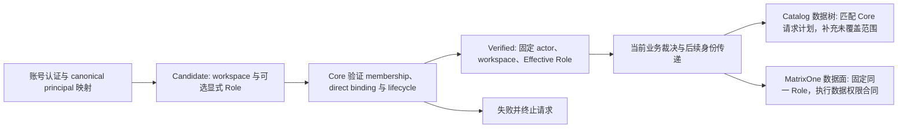

# MOI IAM 请求身份与统一准入

本文定义业务请求如何一次选择并固定 Effective Role、通过公共入口消费 Core 裁决，以及复用同一 Core 请求中的权限事实。它补齐[请求与运行期合同](03-request-runtime-contracts.md)和[请求级授权裁决复用](11-request-authorization-decision-reuse.md)的实现机制，不改变资源/action、Owner、system Role 或独立数据边界的产品语义。

本文对应已完成本地实现的统一准入合同。P1—P4 代码与定向回归完成；实际 Gin 清单的 816 个 workspace 入口均已显式登记，Core canonical 业务权限路由 288/288 已覆盖。P5 本地门禁已建立，CI 跨服务验证与 QA 发布后性能对比尚未执行。具体证据与发布状态以[实现状态](05-implementation-status.md)和[迁移计划](plans/request-principal-admission.md)为准。

本轮范围是同步 workspace 业务请求及其公共 Backend/Core 入口；不重做 Mowl durable context、已登记 RuntimeGrant、system-only 接口或 MatrixOne 会话权限模型。这些路径与新类型相接时仍按各自既有合同传递身份，不能把恢复的审计字段构造成同步业务 Verified/allow。

## 1. 问题与证据

2026-09-21 QA 的 `GET /newmoi/connectors/list?page=1&page_size=10` 暴露了两个公共问题。

第一，Backend workspace middleware 完成 Core 校验后清空 `RoleCandidateID`，写入 `VerifiedEffectiveRoleID`，部分业务 handler 却仍用 `CoreIAMRoleCandidateFrom()` 组装下一次 IAM 请求。Core 收到空 `role_id` 后重新选择 Default Role。显式低权限 Role 与高权限 Default Role 不同时，业务过滤可能使用错误角色；默认角色在请求中途变化也会改变执行身份。

第二，所有使用同一 workspace middleware 的业务接口，都可能支付完整成员展示投影的成本。`CurrentPrincipalRoles` 先验证 membership，再通过 `CurrentMember` 重读 membership、角色绑定、默认角色、绑定版本、属性、资料和展示映射，最后通过 `CurrentPrincipalContext` 再读角色与默认角色。列表的业务权限只需要一个当前有效角色及其 `connector.read` scope。

| QA 样本（北京时间） | Backend | CurrentPrincipalRoles | ResourceAccessFilter |
| --- | ---: | ---: | ---: |
| 2026-09-21 16:30:08，同路径请求 | 2,101 ms | 1,343 ms | 312 ms |
| 2026-09-21 16:37:38，指定工作区只读重放 | 4,879 ms | 3,464 ms | 1,286 ms |

重放 trace 为 `95324c02467f43e2a6cfae07e76f04d9`；成员投影 2,085 ms、角色查询 904 ms、默认角色查询 441 ms。它证明权限读取链路占据主要耗时，不能单独证明具体 SQL 执行、租户连接池或数据库网络中的哪项是底层瓶颈，也不能推导优化后的固定延迟。

当前 connector 列表只调用一次集合 filter，并在 count/分页前应用条件，没有逐 connector 的 PDP 调用。此次设计解决身份状态错误、无用投影和重复事实读取，不把必要的数据边界校验当成冗余。

## 2. 方案选择

| 方案 | 收益 | 代价与限制 | 决定 |
| --- | --- | --- | --- |
| 逐 handler 改取 Effective Role | 立即修复已知角色丢失 | 字符串 DTO 仍可再次丢失角色，公共投影成本不变 | 作为第一批修复 |
| Backend/Redis 缓存角色或 allow | 可减少跨请求查询 | 引入撤权时效、失效和第二套授权事实，不满足现有边界 | 不采用 |
| 新签名通用授权票据或按 request ID 回查裁决 | 可跨 RPC 携带结果 | 新增能力协议、生命周期和接收端验证，容易扩大 allow | 不采用 |
| 扩展既有 context、PEP、IAM API 与 Core fact bag | 类型和 transport 防止身份退化；首个业务裁决可同时完成身份验证；Core 内共享必要事实 | 需要迁移公共 middleware 顺序、生成协议及调用方 | 采用 |

不建立新的权限服务、策略字典或通用流程 DSL。主要 owner 仍为 Backend `ctxutil`、`iampep`、`coreclient` 和 Catalog `iamcore`。收益来自移除明确重复的工作，保留既有 PDP、业务 owner 与一致性校验。

Catalog 数据树复用文档 11 已定义的 Core 签名请求计划。它只覆盖同一活跃 BFF 请求中的固定身份与精确数据范围，不能由普通业务 allow 生成。统一准入复用该计划的匹配与发布入口，不另建通用授权票据。

## 3. 身份状态与权威

### 3.1 只允许一次角色选择

请求身份有两个互斥状态：`Candidate` 和 `Verified`。Core 拒绝时请求终止；成功后只允许 `Candidate -> Verified`，不能退回 Candidate 或再次选择 Default Role。



- 角色、binding、membership、Default Role 及 lifecycle 的事实源和写入方仍是 Core canonical store/PAP；Backend 不新增事实存储。
- `Candidate` 只能由外部入口 adapter 解析。缺省角色只在首次 Core 角色选择时按现有模型解析，包括受保护 system Role 的既有选择规则。
- `Verified` 只能由公共响应校验器消费已认证 Core 响应后构造。必须绑定 canonical principal、workspace、唯一 Role 和当前服务端请求上下文；核对 request/trace、member lifecycle 及显式候选一致性。
- 后续业务 service、adapter 和请求重试只能使用固定 Role。活跃请求计划保存 Core 已验证的角色选择、绑定与主 Role lifecycle 事实；请求中途修改默认角色、解绑或禁用角色，不追溯取消已授权范围。下一独立请求重新验证，失效即拒绝，不能换角色继续。
- 身份验证不等于业务 allow。`Verified` 不带通用 allow 布尔值；已有精确 action facts、collection plan 和独立数据裁决继续各自表达授权范围。

首次准入 RPC 的响应丢失或合同损坏时，BFF 不知道 Core 选择了哪个 Default Role，必须终止当前请求，不能自动重发 Candidate 请求并声称角色未变。调用者的新请求重新准入；Core 在单次 RPC 内发生的既有 snapshot retry 则保留已选角色，按第 5 节重建未完成裁决所需的事实。该准入 RPC 不执行业务写入，因此失败不产生待恢复的业务副作用。

### 3.2 进程内类型

在 `pkg/ctxutil` 现有身份上下文中封装不可变的 `VerifiedPrincipal`，字段不导出。保留只读访问，删除业务代码对候选字段和身份结构体字面量的写入。以下为职责示意：

```go
// 仅验证 Core 响应的公共边界可调用；失败不安装部分身份。
BindVerifiedPrincipal(ctx, expectedRequest, coreResponse) (context.Context, error)

// 业务入口必须已准入；缺失、Candidate 或绑定不一致均返回错误。
RequireVerifiedPrincipal(ctx) (VerifiedPrincipal, error)

// 只读值，不允许调用方覆盖 workspace、principal 或 Role。
principal.WorkspaceID()
principal.PrincipalID()
principal.EffectiveRoleID()
```

公共构造器的合法调用方由包边界 architecture test 限定为认证/PEP 响应校验路径。`middleware` 不反向依赖 `iampep`；二者通过低层 `ctxutil` 类型及既有 verifier 接口协作。业务包不能通过导出 setter、类型转换或本地 system-owner 标记创建 Verified 状态。

`CoreIAMRoleCandidateFrom` 不再是业务层 API。未发布的本地访问器和 DTO 直接迁移，不保留“verified 为空就用 candidate/default”的兼容函数。外部候选解析与内部固定角色校验必须是不同入口，不能使用一个返回空字符串的 getter 同时表示两种阶段。

## 4. 公共准入入口

### 4.1 全量接入同一公共流程

所有已接入 IAM 的同步 workspace API 都必须使用本节公共流程，包括 Web、Product SDK、CLI 对应的 Backend 路由、独立注册的 workspace route group，以及 IAM 管理与 bootstrap 入口。入口认证方式可以不同，但认证后必须收敛到同一 canonical principal、身份状态机和 Core verifier；不能按业务模块保留另一套角色选择、身份拼装或事实缓存。

统一流程为：认证并解析请求身份，首次 Core 准入选择并验证唯一 Effective Role，针对可信资源和 canonical action 生成精确 decision/plan，公共 PEP 绑定结果，业务层消费结果，再于请求结束释放状态。首次身份验证与业务裁决可以在同一个 Core 调用内完成。确需提前解析 parent 的入口也由公共流程安排轻量验证、受限解析和业务裁决，不能由 handler 自行组合。

接口在现有 route 合同中声明资源/action、可信资源 resolver 和所需结果类别；对象 allow/deny、集合 filter、owner plan、已登记 membership-only 和 bootstrap 投影是同一公共机制的不同结果合同。membership-only 只能用于已经登记的能力，不能代替业务 action 裁决。公共组件负责阶段顺序、身份固定、响应绑定、事实复用与出站一致性，业务层不得直接读 Candidate、选 Default Role、手填 acting Role 或重复请求已安装的同一 plan。

覆盖完成必须以实际注册路由与 IAM route/Registry 合同逐项对账为证据：所有应接入入口都有公共执行路径和验证记录，未迁移项为零；新增 IAM 路由遗漏准入声明或绕过公共路径时由启动检查/CI 拒绝。第 1 节的缺陷调用点只是迁移起点，不能替代全量覆盖验收。

Catalog 数据树 receiver 固定同一 Role，先验证并匹配 Core 请求计划，只对未覆盖资源/action 调用 Core PDP。它消费的是 Core 已完成的数据树裁决，普通 BFF 业务 allow 不能替代该计划。MatrixOne 数据执行按独立数据面合同校验。可信非数据树内部调用沿用现有信任合同；本节不为它们新增业务准入。必要的范围补充、数据执行和 parent 解析决定实际 RPC 次数。

### 4.2 将身份验证并入首个业务裁决

Backend 公共请求准备只做账号认证、canonical principal 映射、workspace/candidate 解析和参数形状检查，不读取受保护的 tenant 业务内容。Core 的首次 `Authorize`、`ResourceAccessFilter` 或既有 owner access planning 应调用同一身份 verifier，并同时返回最小 `verified_principal` 与本次 decision/plan。BFF 公共 PEP 校验两者绑定后，原子安装 Verified 身份和精确结果。

Core 必须在打开目标 tenant 查询之前验证 canonical principal 与 workspace membership；取得 tenant 后只验证选定 Role 的 direct binding、provisioning/lifecycle 及当前操作必要的事实。不能为了得到一个角色而拉取全部可选角色、成员资料或展示映射。system Role 快通仍只能由 Core 验证后产生。

既有 `CurrentPrincipalRoles`、`CurrentPrincipalAccessProjection` 继续服务角色选择和 bootstrap 展示；它们复用同一 verifier，需要的展示字段再按需补充。新增轻量 `VerifyCurrentPrincipal` 只服务下表中确实需要提前完成身份验证的路径；它不返回完整成员视图、角色清单、属性、别名或权限 schema，也不返回业务 allow。

| 准入类别与注册 API | 首个 Core 操作与后续业务边界 |
| --- | --- |
| `AdmissionAuthorize` / `RegisterAction` | `Authorize` 同时返回身份与精确 decision；适用于纯请求字段可解析的资源 |
| `AdmissionCollectionFilter` / `Register(CollectionRouteBinding)` | `ResourceAccessFilter` 同时返回身份与 scope；数据树 scope 通过公共入口进入 Core 请求计划；Backend 在 count/分页前消费相同 plan |
| `AdmissionCoreOwnerProjection` / `Register(CoreOwnerProjectionRouteBinding)` | 轻量验证固定 Role；既有 Core owner 唯一执行过滤、分页与 final fence |
| `AdmissionMembership` / `RegisterMembership` | 轻量验证后进入已有成员级能力；不产生业务 action allow |
| `AdmissionResolvedAuthorize` / `RegisterResolvedAction` | 轻量验证后由可信 owner 解析最小父资源，再裁决 action，业务结果与副作用等待 allow |
| `AdmissionWorkspaceCollection` / `RegisterWorkspaceCollection` | 合并 workspace action；仅结构化 permission-denied 使用 owner 已定义的空结果 |
| `AdmissionCoreOperation` / `RegisterCoreOperation` | 轻量验证后执行既有 Core PAP 复合授权、Owner 替代路径与事务 fence |
| `AdmissionCanonicalObjectRead` / `RegisterCanonicalObjectRead` | 使用已封闭的 canonical 类型/action 映射，合并身份与对象读裁决 |
| `AdmissionDataAccess` / `RegisterDataAccess` | 轻量验证只固定身份；数据树 owner 匹配或补充 Core 请求计划，MatrixOne 执行独立数据权限合同 |
| `AdmissionResolvedAll` / `RegisterResolvedAll` | 轻量验证后解析 owner 批量资源并执行 `RequireAll`；任一拒绝不执行业务批次 |
| `AdmissionRuntimePolicy` / `RegisterRuntimePolicy` | 轻量验证后执行已存在的条件/批量策略；不得把 membership 当成策略 allow |
| `AdmissionPrincipalProjection` / `RegisterPrincipalProjection` | `/user/info`、`/iam/me/roles`、`/iam/me/capabilities` 各取一次既有完整投影，同时用于准入和响应 |


已有 Core owner 独占过滤和分页、且其业务 API 尚未返回准入身份时，显式登记为 `AdmissionCoreOwnerProjection`：公共组件轻量验证并固定角色，原 owner 业务调用执行唯一过滤。Workbook、Workflow、Agent 等 owner list 当前采用此路径。该类别不把 identity 当成业务 allow，也不在 BFF 追加同一个 filter；后续若合并 owner 协议，须一起迁移业务 DTO、SDK 和 final fence 合同。

身份投影不跨请求合并：`CurrentPrincipalRoles` 每次请求使用独立 Core 调用和原始 request/trace 绑定，不能重写响应关联标识让其它请求复用。取消一个请求不影响另一个请求。

对于父资源解析、Core PAP、运行期条件策略和独立数据边界，首次准入只证明身份。后续 action/PAP/数据裁决仍由各自 owner 负责，数据树已覆盖范围消费 Core 请求计划；轻量验证后允许 owner 获取解析所需的租户上下文和最小元数据，不宣称所有路径在业务 PDP 拒绝前都没有连接或元数据读取。

这些类别是现有 RouteBinding/Registry route contract 的执行属性，不是另一份 action 权限表。路由必须显式声明类别；公共 client 不按 URL、布尔标记或响应内容猜测类别。未知或未完成绑定的 route 在启动检查/CI 拒绝，运行时缺少必需身份或 plan 时 fail closed，不能自动降为 membership-only。

迁移后的 connector 列表顺序为：

```text
认证与 principal 映射 -> 解析 workspace/candidate/page
-> 一次 Core ResourceAccessFilter（身份验证 + connector.read scope）
-> 原子安装 VerifiedPrincipal 与绑定的 filter plan
-> 获取 Backend tenant DB -> scope WHERE -> count/page -> 批量关联任务
```

必须同时调整现有 `ResolveWorkspaceCanonical -> TenantDB -> route PEP` 的组装方式，并把 filter 移到取业务 DB 之前。只删除 workspace middleware、或只给响应增加角色字段，都不构成迁移完成。service 只消费公共 PEP 安装的绑定 plan，不能再发起同一个 filter，也不能因 plan 缺失而查询全部。

### 4.3 IAM body 与执行 header 同源

Backend-owned filter DTO 不再由 handler 分别提供 workspace、principal 和 acting Role；handler 只提供业务 resource/action/filter 参数，`iampep` adapter 从请求身份统一构造 IAM 输入。`coreclient` 继续负责执行身份和 header 编码，不解析策略、不修改业务 payload。

- 首次准入：公共 adapter 明确消费 Candidate；未指定角色允许 Core 选择一次 Default Role。
- 准入之后：acting `role_id` 必须等于 `VerifiedPrincipal.EffectiveRoleID()`；同时存在的 body/header 角色必须完全一致。空值或不一致是合同错误，发送前拒绝，不能静默补成默认角色或覆盖冲突值。
- Core IAM 接收边界对已认证 delegated execution 再检查 body/header 的 principal、workspace 和 acting Role 一致性；存在已验证角色 header 时，空 body Role 不能重新触发默认选择。检查身份绑定不等于继承 BFF 业务 allow。
- `target_role_id` 及管理目标中的 `role_id` 不属于 acting Role。每类生成 DTO 的显式 adapter 必须区分 actor 与 target，禁止按字段名反射替换、遍历所有 `role_id` 或从 URL 推断。
- `Require`、`RequireAll`、`RequireDependencies` 首次准入后也必须使用同一 Verified 身份，不再次调用外部候选 resolver；重试和后续新 action 都不能重新选择角色。

协议中的 `verified_principal` 是已认证响应的身份事实，不是签名票据、bearer capability 或可跨请求复用的授权凭证。只读字段至少包含 canonical principal、workspace、Effective Role 和关联标识；不暴露 user secret 或完整 policy。字段由 proto 生成到 Core SDK，禁止手改生成类型。已有 published request 字段仍可保留在 wire 上，其赋值和一致性由公共 adapter 管理。

只有 verifier 完成全部身份校验后，响应才能提供可安装的 `verified_principal`。allow 与合法 empty collection 必须携带该结构；point deny 仍直接结束业务请求，不通过附带身份继续其它动作。Backend 必须将 decision/plan 与它作为同一个完整响应校验，不能在部分解码成功、Core error 或 plan malformed 时先安装身份再继续。

## 5. Core 请求内复用

### 5.1 复用事实，保留最终一致性证明

扩展 `iamcore.BindIAMPrincipalAccessFacts`，由 Core HTTP/owner 请求入口在第一次读取前绑定；身份 verifier、`Authorize`、`ResourceAccessFilter` 和 owner plan 接收同一 context。不得只在每个 PDP 内部各建一份 bag。

fact key 必须包含事实类型、workspace、principal、固定 Role、资源标识及所处事务/裁决 attempt。相同 key 并发读取合并为一次读取，结果对消费者只读；等待者遵守 context 取消，不遗留 goroutine。缓存中的错误不转成空集合或 allow，同一失败 attempt 不在底层 helper 中自行重试。

membership、默认角色原始记录、当前 Role 的 direct binding/lifecycle 在同一 attempt 内复用。Core 完成身份验证后，活跃 Catalog 请求计划另外保存经过验证的角色选择、主 Role lifecycle 与 system Role 分类，后续子请求和新裁决 attempt 复用这些可信事实。展示 DTO 不能生成该证明；展示 Default Role 不得改变固定身份。

尚未完成的裁决仍执行所需的 policy、Role Graph、继承 Role lifecycle 和 Owner proof final read/readback；这些 fence 不能由普通 fact bag 替代。已由活跃请求计划确认的 direct binding 与主 Role lifecycle 使用冻结事实，不再次读取。没有该请求计划的独立 Core 调用保留原有角色校验与 final fence。已登记的 batch projection 继续拥有自身的合并 fence，待完成 `OwnerAccessPlan` 和 PAP 写入继续执行各自事务与资源一致性合同。

一次裁决因 snapshot 漂移重试时重建 attempt fact bag，丢弃未完成结果，重新读取该裁决所需的当前 policy、Role Graph 等事实。活跃请求计划中的固定身份与已完成精确范围继续有效；没有该计划时重验同一个已选 Role，失效即拒绝，不能重选 Default Role。沿用 owner 已有的有界重试与错误分类。请求中发生权限或 Ownership 修改后，新范围在新 attempt 中补充裁决；已完成范围不追溯重算，业务对象存在性、workspace、挂载关系及业务 lifecycle 仍由 owner 校验。

### 5.2 精确结果复用

已完成 decision 或 collection plan 只在同一请求、同一裁决边界内复用。key 包含 actor、workspace、固定 Role、canonical action/operation、完整 resource/parent 集合及参与条件求值的上下文；不能只按 action、Role、`request_id` 或 `trace_id` 命中。

- point 与 collection 范围不互相升级，read 不授予 update/use；多个 action 分别裁决。
- 待完成 `OwnerAccessPlan` 不作为完成的 allow 使用；必须保留其业务查询、candidate projection 和 final fence。
- Catalog 数据树集合已完成 active Ownership 校验并物化为精确 ID 后，通过公共 filter 入口写入 Core 请求计划；后续查询消费同一范围，不再次附加 Ownership 权限条件。首次合并准入和普通 filter 必须使用同一匹配与发布入口。
- Core 请求内不同 action 可以共享身份事实，但必须各自产生决策；业务 owner 可通过已有复合操作完成这些检查，不新增任意策略执行 DSL。
- BFF 只复用 Core 返回且绑定完整的精确结果；不得在 BFF 重建 policy、Role graph 或 Owner 判断。

### 5.3 进程与资源边界

fact bag 只活在当前 Core 请求/attempt 的内存中，不序列化到另一个 RPC。跨 Catalog 子请求的复用只通过文档 11 的 Core 签名计划完成，接收方验证随机请求实例、principal、workspace、固定 Role 和精确范围。`request_id` / `trace_id` 相同不能检索或生成 allow，BFF 的 Verified 身份本身也不能授予数据树范围。

简单 connector list 的目标是一项合并准入 RPC；必须先查 Backend parent 的路径允许“轻量身份验证 + action 裁决”两步。Catalog 数据树已覆盖范围精确复用，首次或未覆盖范围由 Core 产生新裁决，失败关闭；计划命中不依赖 PDP 再次可用，业务 HTTP 与数据访问仍须正常完成。MatrixOne SQL 执行继续使用固定 Active Role 并遵守数据面合同，Mowl/Worker 的独立数据调用不继承原 BFF 请求计划。已确认可信的非数据树 Catalog 调用继续直接执行业务。

这一区分避免把“所有接口只有一次 RPC”作为错误目标。要消除的是同一边界内等价的重复工作，不是不同资源动作或独立数据边界的必要校验。

fact/decision 集合受对应 route 的输入、批量资源和 Role Graph 现有预算约束；超预算在扩大查询前失败，不截断授权范围或改用全量查询。新复合入口必须声明 item 上限，不能接受无界列表。请求结束或取消后释放全部状态，不建全局 cache、后台刷新或额外连接池，不把 fact bag 存入 Mowl durable context。

## 6. 错误、观测与验收

轻量验证、合并 `Authorize` 和合并 `ResourceAccessFilter` 共用准入错误分类：Core 将已确认的成员不存在、禁用或删除编码为 `WORKSPACE_MEMBERSHIP_REVOKED`，Backend 保持 `403 ErrWorkspaceMembershipRevoked`；当前角色验证拒绝编码为 `EFFECTIVE_ROLE_DENIED`，Backend 保持 `403 ErrIAMEffectiveRoleDenied`。Core 在身份校验 owner 标记失败阶段并保留原始 cause；只有已确认的身份拒绝才能使用这两个分类，存储与 transport 故障沿用不可用分类，身份成功后的业务拒绝继续使用 `PERMISSION_DENIED`。不得依据错误文案推断，也不得把成员不存在的内部 404 转成 503。

外部候选非法或失效保留现有 403；Core/storage 不可用、缺失或损坏的准入响应、内部已验证身份丢失/冲突使用既有 unavailable/合同错误分类，且在受保护读取或副作用前终止。若当前错误码无法区分内部合同损坏，先按公开错误合同补充稳定 reason，不能把它返回为 200 空列表。合法 empty scope 仍为 200 空集合。

QA 验收复用既有 trace phase 机制分别观测 `principal.verify`、action/filter、业务查询及 freshness fence；分开统计角色选择次数、IAM RPC 次数、不同 decision key 数、实际 fact read 数和必要 fence read 数。指标只使用有界的 route/action/outcome/phase；principal、workspace、Role、request/trace 只进入受控日志，不作为指标 label。本轮读取/RPC 数量由定向测试断言；正常请求的线上延迟分布与查询耗时仍需部署后观测，不能只依赖当前 3 秒慢日志阈值或据此声称已有 p95 改善。

| 不变量 | 必须提供的证明 |
| --- | --- |
| 显式低权限 Role 不变 | 真实生产 middleware 顺序，Default Role 为 admin，显式 Role 为 restricted；Core proto body、执行 header、最终结果均使用 restricted |
| 默认只选择一次 | 无显式候选时验证一次；中途修改 Default Role 或发生有界 snapshot retry，不改本次 Role；下一独立请求使用新默认 |
| 空/冲突不能掩盖 | Candidate 状态误入业务、verified 缺失、body/header 不一致、actor/target Role 混淆、响应绑定不符均在业务 I/O 前失败 |
| 公共入口覆盖 | 实际注册路由与 IAM route/Registry 合同全量对账，所有应接入入口使用公共流程且未迁移项为零；route/action checker 与包边界测试覆盖对象、集合、membership、bootstrap、parent resolver；同步业务不使用 Candidate 重新选 Role，Verified 构造仅在公共 Core 响应边界 |
| 合并准入成立 | connector 普通/system Role 路径均只发一次 filter RPC；不调用 CurrentPrincipalRoles；empty scope 不取业务行 |
| 事实复用正确 | 同一 Core attempt 相同 fact 并发只读一次；活跃请求保留验证后的角色事实；未完成裁决所需 fence 独立计数；错误、取消和漂移重试不复用未完成结果 |
| 数据树计划衔接 | Verify、合并 Authorize/filter 保留 Role Source/Version；首次数据树 filter 生成的精确范围可供下一 Catalog 子请求复用，Owner ID 不重复校验；普通业务 allow 不生成数据树计划 |
| 边界未削弱 | 新 action/resource 由 Core 补充；point/collection 不互相授权；新请求重新验证撤权；tenant/actor/Role/实例不匹配不能复用，相同关联 ID 也不例外 |
| 性能收益真实 | 同环境、同数据量/角色/并发下比较 RPC/SQL 计数与 p50/p95，业务 SQL 成本单独统计；不把单次 QA 样本当 SLO |

机械门禁和真实链路测试的具体要求见[验证与漂移控制](06-verification-drift-control.md)。本设计不以文字约定替代测试；所有生产调用点、协议、包边界和 route 组装迁移完成后，才能在实现状态中标记完成。

## 7. 设计判断

方案选择为 `PASS`：固定角色是必须满足的正确性约束；公共类型与 transport 校验直接阻止已确认的跨模块缺陷，轻量验证和合并首次裁决移除有日志证据的多余投影。主要成本是公共 middleware 与协议迁移，按先修复角色、再扩展 Core、最后迁移 route 的顺序控制；不引入跨请求授权状态、缓存失效或新的服务。

接口边界、失败语义、版本顺序和验收条件已可用于分步实现。剩余不确定性是租户数据库延迟及各 route 的必要 parent 解析成本，必须通过实际查询计数和同负载测量验收。若某类 route 合并 RPC 需要新的跨 owner 依赖，应保留已定义的轻量两步路径，不为一次 RPC 指标扩大架构改动。
